# dc-networking

Cross-team tracker for the networking side of
[decoupled consensus](https://ethresear.ch/t/unblocking-faster-finality-with-decoupled-consensus/24527)
with post-quantum signatures (PQ-DC): delivering and aggregating hash-based
AC (available-chain) and FG (finality-gadget) votes at validator-set scale.

**2026-11-12:** [ACDC #191](https://forkcast.org/calls/acdc/191) dropped BLS
decoupled consensus; DC work targets PQ from the start. Start at
[`research/pq/`](research/pq/README.md). BLS-era material is kept in
[`bls/`](bls/README.md).

  <picture>
    <source media="(prefers-color-scheme: dark)" srcset="assets/dc-animation-dark.svg">
    
  </picture>

## Layout

| Path | What |
|---|---|
| [`properties.md`](properties.md) | What we want from the p2p layer (draft); each property comes with a proposal |
| [`design/`](design/) | [`requirements.md`](design/requirements.md) (binding parameter envelope — changes are decisions, date them; PQ rework next) and [`incentives.md`](design/incentives.md) (reward proposal) |
| [`research/`](research/) | Reasoning behind design decisions and design options: [`open_questions.md`](research/open_questions.md) (settled vs. open tracker), [`pq/`](research/pq/README.md) (PQ-DC: sources, load and aggregation arithmetic), [`pq-gasper/`](research/pq-gasper/README.md) (the PQ Gasper alternative: avenues and compromises), [`ac/`](research/ac/) (AC slot structure), [`fg/`](research/fg/) (FG round: [`pipelined-units/`](research/fg/pipelined-units/) Q17 — 4 s + 4 s vote units, three per slot; [`staggered-committees/`](research/fg/staggered-committees/) Q18; [`free-running-committees/`](research/fg/free-running-committees/) Q19), [`transitions/`](research/transitions/) (epoch/height transition timing vs. early FG votes), [`consolidation/`](research/consolidation/) (non-consolidated validators per unique withdrawal address), [`clients/silver/`](research/clients/silver/) (Gattaca's Silver client: gossipsub changes and the 2 Gbit/s claim) |
| [`specs/`](specs/) | Exact specifications (to come) — meanwhile [`README.md`](specs/README.md) points at Francesco's executable Simplex pyspec |
| [`poc/`](poc/) | Proof of concept: [`poc.md`](poc/poc.md) (Shadow → Prysm-on-Shadow → Kurtosis) |
| [`benchmarking/`](benchmarking/) | Benchmark results, all with BLS votes so far: [`devnet-0/`](benchmarking/devnet-0/) (non-finality devnet) and [`devnet-1/`](benchmarking/devnet-1/) (loaded-run comparison, [dashboard](https://dc-devnet-1-comparison.citrusvole32.chatgpt.site)) |
| [`bls/`](bls/README.md) | BLS-era material, kept for reference: the BLS-era explainer, SSZ byte accounting, early FG notes |
| [`meetings/`](meetings/) | Meeting notes, one file per call: `YYYY-MM-DD.md` |
| `personal/<name>/` | Personal scratchpads — unreviewed |
