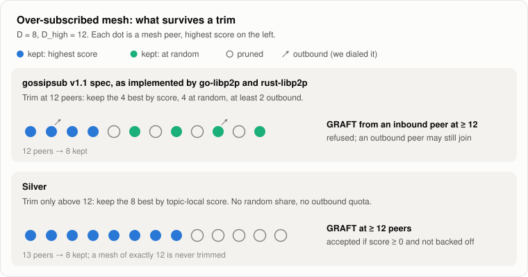
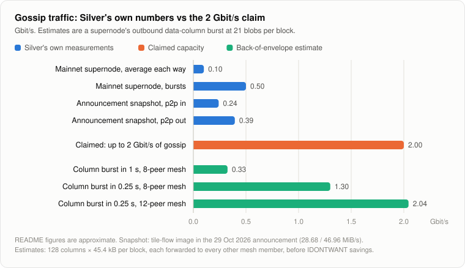

# Gattaca's Silver client: what it changes in gossipsub

[Silver](https://github.com/gattaca-com/silver) is a new Ethereum consensus client from Gattaca, written from scratch in Rust and announced on 29 October 2026 in [*Introducing Silver*](https://x.com/gattacahq/status/2115835196360569086). This note reads its gossipsub stack at commit [`0896b4dd`](https://github.com/gattaca-com/silver/tree/0896b4ddc9c94ee30f3f91fde6f29ffd5a402668) and compares it with the gossipsub specs, go-libp2p, rust-libp2p and the Ethereum consensus specs. Every code reference links to that commit.

Silver runs as six *tiles*: threads pinned to CPU cores that exchange messages over lock-free queues and keep bulk bytes in shared-memory rings. Its gossipsub stack is written from scratch rather than taken from rust-libp2p. [`crates/gossip/`](https://github.com/gattaca-com/silver/tree/0896b4ddc9c94ee30f3f91fde6f29ffd5a402668/crates/gossip) holds the wire codec, dedup, message cache and partial messages; [`crates/peer/`](https://github.com/gattaca-com/silver/tree/0896b4ddc9c94ee30f3f91fde6f29ffd5a402668/crates/peer) the mesh, scoring and peer management; [`crates/network/`](https://github.com/gattaca-com/silver/tree/0896b4ddc9c94ee30f3f91fde6f29ffd5a402668/crates/network) a QUIC-only transport on `quinn-proto`.

## At a glance

- **No new protocol.** Silver stays wire-compatible with meshsub 1.2 and 1.3.
- **It drops gossipsub v1.1's mesh-takeover protections.** Over-subscribed meshes are trimmed purely by score, with no random share and no outbound quota. GRAFTs are accepted at `D_high`, and mesh decisions use a topic-local score.
- **It catches up elsewhere:** relay before import, rust-libp2p's IDONTWANT defaults, advertised PRUNE backoff, gossipsub 1.3 with Partial Messages for data columns, and dual meshes across forks.
- **Its transport is strict and lean.** A peer that leaves data un-ACKed for 10 s, or stalls a frame for 1 s, is disconnected. Forwarding copies a message once and never recompresses it.
- **Two behaviours look unintended.** First-delivery credit is granted before validation, and receive-path dedup remembers about 48 s or 3 min instead of the spec's 768 s.
- **"2 Gbit/s of gossip traffic" is most likely a two-host benchmark ceiling,** not observed traffic. Silver's own figures for a mainnet supernode are about 0.1 Gbit/s on average and 0.5 Gbit/s in bursts.

## 1. Departures from gossipsub v1.1

<picture>
  <source media="(prefers-color-scheme: dark)" srcset="figures/mesh-trim-dark.svg">
  
</picture>

The v1.1 spec sets three rules for an over-subscribed mesh ([`gossipsub-v1.1.md:186–199`](https://github.com/libp2p/specs/blob/c750236de43cd8b246a824b377dfdb26bae686db/pubsub/gossipsub/gossipsub-v1.1.md?plain=1#L186-L199), [`gossipsub-v1.1.md:249–256`](https://github.com/libp2p/specs/blob/c750236de43cd8b246a824b377dfdb26bae686db/pubsub/gossipsub/gossipsub-v1.1.md?plain=1#L249-L256)):

- Keep the best `D_score` peers and fill the rest at random.
- Keep at least `D_out` outbound connections.
- Accept a GRAFT at degree ≥ `D_hi` only from an outbound connection.

The spec presents these as protection against mesh takeover. go-libp2p ([`gossipsub.go:958–965`](https://github.com/libp2p/go-libp2p-pubsub/blob/3f89e4331c981a6b60206b762a10d015c04875a8/gossipsub.go#L958-L965), [`gossipsub.go:1527–1601`](https://github.com/libp2p/go-libp2p-pubsub/blob/3f89e4331c981a6b60206b762a10d015c04875a8/gossipsub.go#L1527-L1601)) and rust-libp2p ([`behaviour.rs:1635–1636`](https://github.com/libp2p/rust-libp2p/blob/c449090f49b5ae2338e8f0727be98e0a739ba135/protocols/gossipsub/src/behaviour.rs#L1635-L1636), [`behaviour.rs:2421`](https://github.com/libp2p/rust-libp2p/blob/c449090f49b5ae2338e8f0727be98e0a739ba135/protocols/gossipsub/src/behaviour.rs#L2421)) implement them. Silver drops all three:

- **Score-only eviction** ([`peers.rs:1136`](https://github.com/gattaca-com/silver/blob/0896b4ddc9c94ee30f3f91fde6f29ffd5a402668/crates/peer/src/manager/peers.rs#L1136)). The code calls it a "deliberate spec deviation: proven deliverers are never displaced by unproven newcomers" ([`peers.rs:1157–1166`](https://github.com/gattaca-com/silver/blob/0896b4ddc9c94ee30f3f91fde6f29ffd5a402668/crates/peer/src/manager/peers.rs#L1157-L1166)). Above `D_high` the lowest selection score goes first. There is no random share and no outbound quota: Silver records which side dialed ([`state.rs:43`](https://github.com/gattaca-com/silver/blob/0896b4ddc9c94ee30f3f91fde6f29ffd5a402668/crates/peer/src/state.rs#L43)) but never uses it in mesh selection. Peers inside an opportunistic-graft grace window, and trusted peers, are exempt.
- **GRAFTs accepted at `D_high`** since [#192](https://github.com/gattaca-com/silver/pull/192) (24 August 2026), which removed a `mesh_size < d_high` check. A GRAFT is now accepted if Silver subscribes to the topic, the peer's score is ≥ 0 and the peer is not backed off; trusted peers always pass ([`peers.rs:692–697`](https://github.com/gattaca-com/silver/blob/0896b4ddc9c94ee30f3f91fde6f29ffd5a402668/crates/peer/src/manager/peers.rs#L692-L697)). Silver's comment there says reference gossipsub "accepts and lets the heartbeat trim past d_high". In fact go-libp2p and rust-libp2p both refuse such a GRAFT unless the peer is an outbound connection.
- **Trim only strictly above `D_high`** ([#175](https://github.com/gattaca-com/silver/pull/175)). This follows the v1.0 pseudo-code `if |mesh[topic]| > D_high` ([`gossipsub-v1.0.md:434`](https://github.com/libp2p/specs/blob/c750236de43cd8b246a824b377dfdb26bae686db/pubsub/gossipsub/gossipsub-v1.0.md?plain=1#L434)). go-libp2p and rust-libp2p trim at `≥ D_high`, as Silver itself did before #175. Together with #192, a Silver mesh can sit at 12 peers indefinitely.
- **Topic-local selection score** ([`scoring.rs:92`](https://github.com/gattaca-com/silver/blob/0896b4ddc9c94ee30f3f91fde6f29ffd5a402668/crates/peer/src/scoring.rs#L92)). Over-cap eviction and the opportunistic-graft trigger use the global score minus P1 and P2, plus the P1 and P2 earned on this topic alone. The spec ranks on a peer's global score. Silver's rationale: tenure in other meshes is not evidence about this one.
- **Opportunistic graft keyed to topic-local merit** ([`peers.rs:1207`](https://github.com/gattaca-com/silver/blob/0896b4ddc9c94ee30f3f91fde6f29ffd5a402668/crates/peer/src/manager/peers.rs#L1207)).
  - Every 60 s Silver takes the median selection score of members meshed for at least 384 s.
  - If that median is below 0.25 × the topic class's saturation ([`scoring.rs:136`](https://github.com/gattaca-com/silver/blob/0896b4ddc9c94ee30f3f91fde6f29ffd5a402668/crates/peer/src/scoring.rs#L136)), Silver grafts up to 2 random candidates ([`peers.rs:1269–1270`](https://github.com/gattaca-com/silver/blob/0896b4ddc9c94ee30f3f91fde6f29ffd5a402668/crates/peer/src/manager/peers.rs#L1269-L1270)).
  - A candidate qualifies if its "candidate score" beats the members' median on that scale ([`scoring.rs:122`](https://github.com/gattaca-com/silver/blob/0896b4ddc9c94ee30f3f91fde6f29ffd5a402668/crates/peer/src/scoring.rs#L122)).
  - The spec and go-libp2p trigger on an absolute threshold of the global score; the random above-median pick matches go-libp2p ([`gossipsub.go:1634–1642`](https://github.com/libp2p/go-libp2p-pubsub/blob/3f89e4331c981a6b60206b762a10d015c04875a8/gossipsub.go#L1634-L1642)).
  - No new round starts while the previous round's grafts are still inside the 384 s window.
- **Escalating re-graft backoff** ([`peers.rs:725`](https://github.com/gattaca-com/silver/blob/0896b4ddc9c94ee30f3f91fde6f29ffd5a402668/crates/peer/src/manager/peers.rs#L725)). This is a legal extension rather than a deviation: the spec only requires waiting at least the advertised backoff ([`gossipsub-v1.1.md:114–116`](https://github.com/libp2p/specs/blob/c750236de43cd8b246a824b377dfdb26bae686db/pubsub/gossipsub/gossipsub-v1.1.md?plain=1#L114-L116)).
  - Silver reads a PRUNE within 5 s of meshing ([`peers.rs:25`](https://github.com/gattaca-com/silver/blob/0896b4ddc9c94ee30f3f91fde6f29ffd5a402668/crates/peer/src/manager/peers.rs#L25)) as the remote's mesh being full: a heartbeat trim, or an immediate GRAFT refusal at `D_hi`.
  - For k consecutive quick prunes it multiplies the remote's advertised backoff (60 s by default) by 2^k, with k ≤ 4 ([`peers.rs:768–771`](https://github.com/gattaca-com/silver/blob/0896b4ddc9c94ee30f3f91fde6f29ffd5a402668/crates/peer/src/manager/peers.rs#L768-L771)). The wait grows from 60 s to at most 960 s.
  - A prune after a longer stay resets k.
- **IHAVE targets by rotation** ([`promises.rs:273`](https://github.com/gattaca-com/silver/blob/0896b4ddc9c94ee30f3f91fde6f29ffd5a402668/crates/peer/src/manager/promises.rs#L273)). The spec emits gossip to "a random selection of peers" ([`gossipsub-v1.0.md:477`](https://github.com/libp2p/specs/blob/c750236de43cd8b246a824b377dfdb26bae686db/pubsub/gossipsub/gossipsub-v1.0.md?plain=1#L477)); Silver walks a rotating cursor over the subscriber list ([`promises.rs:315`](https://github.com/gattaca-com/silver/blob/0896b4ddc9c94ee30f3f91fde6f29ffd5a402668/crates/peer/src/manager/promises.rs#L315)). It sends to `max(D_lazy, 0.1 × subscribers)` peers, where the spec's default factor is 0.25 ([`gossipsub-v1.1.md:550`](https://github.com/libp2p/specs/blob/c750236de43cd8b246a824b377dfdb26bae686db/pubsub/gossipsub/gossipsub-v1.1.md?plain=1#L550)).
- **Protocol versions and caches.**
  - Silver negotiates `/meshsub/1.3.0` and falls back only to `/meshsub/1.2.0` ([`stream_protocol.rs:139–149`](https://github.com/gattaca-com/silver/blob/0896b4ddc9c94ee30f3f91fde6f29ffd5a402668/crates/common/src/spine/stream_protocol.rs#L139-L149)). It offers no `/meshsub/1.1.0`, the ID the Ethereum spec still names ([`phase0/p2p-interface.md:431`](https://github.com/ethereum/consensus-specs/blob/a7ab94b72eab717f30389eedfce5aea5f05579d7/specs/phase0/p2p-interface.md?plain=1#L431)).
  - The message cache keeps 12 heartbeat windows where the spec has 6, and gossips the last 3 ([`mcache.rs:16–18`](https://github.com/gattaca-com/silver/blob/0896b4ddc9c94ee30f3f91fde6f29ffd5a402668/crates/gossip/src/mcache.rs#L16-L18); [`phase0/p2p-interface.md:446–448`](https://github.com/ethereum/consensus-specs/blob/a7ab94b72eab717f30389eedfce5aea5f05579d7/specs/phase0/p2p-interface.md?plain=1#L446-L448)).
  - Outbound IHAVEs carry at most 500 ids per topic ([`mcache.rs:19`](https://github.com/gattaca-com/silver/blob/0896b4ddc9c94ee30f3f91fde6f29ffd5a402668/crates/gossip/src/mcache.rs#L19)); go-libp2p allows 5,000 ([`gossipsub.go:70`](https://github.com/libp2p/go-libp2p-pubsub/blob/3f89e4331c981a6b60206b762a10d015c04875a8/gossipsub.go#L70)).

## 2. Parameter and peer-management choices

These stay inside the v1.1 parameters. Every `ScoreParams` value is a default that a node's config file can override ([`config/lib.rs:154`](https://github.com/gattaca-com/silver/blob/0896b4ddc9c94ee30f3f91fde6f29ffd5a402668/crates/config/src/lib.rs#L154)). Hard-coded: the per-class P2 table, the backoff escalation, the opportunistic-graft interval and count, the IDONTWANT threshold, and idle-peer shedding.

- **Per-class P2 caps and weights** ([`scoring.rs:32–49`](https://github.com/gattaca-com/silver/blob/0896b4ddc9c94ee30f3f91fde6f29ffd5a402668/crates/peer/src/scoring.rs#L32-L49)). Maximum first-delivery (P2) contribution per topic:
  - block and execution-payload envelope 20, aggregates 20, sync-committee contributions 10
  - payload attestations and bids 5
  - data columns 2.5 per subnet, attestation and sync subnets 1 per subnet, other topics 1

  The code comment explains why: "with the global cap, one attestation subnet was worth 1000 points against a −80 graylist". Mesh-delivery scoring (P3) is off for data columns, bids and other topics; elsewhere its threshold is 0.685.
- **Softer misbehaviour scoring.**
  - The behaviour penalty (P7) has a free budget of 5 before the squared excess counts ([`peer_score_params.rs:184`](https://github.com/gattaca-com/silver/blob/0896b4ddc9c94ee30f3f91fde6f29ffd5a402668/crates/config/src/peer_score_params.rs#L184)). With a threshold of 0, a single benign event cost −10, which equals the gossip gate.
  - The RPC-fault score (P5) decays by ×0.95 once per 12 s slot ([`manager/mod.rs:571`](https://github.com/gattaca-com/silver/blob/0896b4ddc9c94ee30f3f91fde6f29ffd5a402668/crates/peer/src/manager/mod.rs#L571)), so a −5 fault halves in about 2.7 minutes. The code comment's "~1 min" ([`peer_score_params.rs:174–175`](https://github.com/gattaca-com/silver/blob/0896b4ddc9c94ee30f3f91fde6f29ffd5a402668/crates/config/src/peer_score_params.rs#L174-L175)) is too optimistic.
- **A large peer set** ([`peer_score_params.rs:211`](https://github.com/gattaca-com/silver/blob/0896b4ddc9c94ee30f3f91fde6f29ffd5a402668/crates/config/src/peer_score_params.rs#L211)). Defaults: 300 target peers, a priority cap of 500 and a connection cap of 600.
  - A peer that covers a subnet still short of `D` after a mesh sweep may be dialed up to the priority cap + 10 % ([`admission.rs:134`](https://github.com/gattaca-com/silver/blob/0896b4ddc9c94ee30f3f91fde6f29ffd5a402668/crates/peer/src/manager/admission.rs#L134)).
  - Peers connected for over 30 minutes with no mesh slot and a score ≤ 0.1 are disconnected with Goodbye code 129, but only while above the priority cap ([`manager/mod.rs:63–71`](https://github.com/gattaca-com/silver/blob/0896b4ddc9c94ee30f3f91fde6f29ffd5a402668/crates/peer/src/manager/mod.rs#L63-L71)).
- **Trusted peers** ([#213](https://github.com/gattaca-com/silver/pull/213)) are always accepted on GRAFT and never pruned for score or the cap.

## 3. Catch-up to the spec and reference clients

- **Relay blocks before import** ([#174](https://github.com/gattaca-com/silver/pull/174)). A block is forwarded once its prechecks and proposer signature pass, before the state transition and fork choice ([`gossip.rs:1800–1805`](https://github.com/gattaca-com/silver/blob/0896b4ddc9c94ee30f3f91fde6f29ffd5a402668/crates/beacon_state/tile/src/tile/gossip.rs#L1800-L1805)). The spec only asks for gossip validation before forwarding. Before #174, Silver forwarded after full import.
- **IDONTWANT now matches rust-libp2p's defaults** ([#392](https://github.com/gattaca-com/silver/pull/392)).
  - Silver sends IDONTWANT only for received messages whose encoded protobuf exceeds 1,000 B ([`message.rs:16`](https://github.com/gattaca-com/silver/blob/0896b4ddc9c94ee30f3f91fde6f29ffd5a402668/crates/gossip/src/message.rs#L16), [`message.rs:154–155`](https://github.com/gattaca-com/silver/blob/0896b4ddc9c94ee30f3f91fde6f29ffd5a402668/crates/gossip/src/message.rs#L154-L155)).
  - It never sends one for a message it publishes itself. #392 removed it from the one publish path that had it, locally published data columns.
  - That is exactly rust-libp2p's default: a 1,000 B threshold on the encoded message and `idontwant_on_publish = false` ([`config.rs:559–560`](https://github.com/libp2p/rust-libp2p/blob/c449090f49b5ae2338e8f0727be98e0a739ba135/protocols/gossipsub/src/config.rs#L559-L560), [`behaviour.rs:1960–1961`](https://github.com/libp2p/rust-libp2p/blob/c449090f49b5ae2338e8f0727be98e0a739ba135/protocols/gossipsub/src/behaviour.rs#L1960-L1961)).
  - go-libp2p also sends IDONTWANT for its own publishes, with a 1,024 B threshold on the data field ([`gossipsub.go:713–741`](https://github.com/libp2p/go-libp2p-pubsub/blob/3f89e4331c981a6b60206b762a10d015c04875a8/gossipsub.go#L713-L741), [`topic.go:352`](https://github.com/libp2p/go-libp2p-pubsub/blob/3f89e4331c981a6b60206b762a10d015c04875a8/topic.go#L352)).
  - The v1.2 spec leaves the policy to implementations ([`gossipsub-v1.2.md:71–75`](https://github.com/libp2p/specs/blob/c750236de43cd8b246a824b377dfdb26bae686db/pubsub/gossipsub/gossipsub-v1.2.md?plain=1#L71-L75)).
- **IHAVE gossip factor** ([#401](https://github.com/gattaca-com/silver/pull/401)): `max(D_lazy, factor × subscribers)` peers instead of a flat `D_lazy` ([`promises.rs:293–296`](https://github.com/gattaca-com/silver/blob/0896b4ddc9c94ee30f3f91fde6f29ffd5a402668/crates/peer/src/manager/promises.rs#L293-L296)).
- **Advertised PRUNE backoff** ([#197](https://github.com/gattaca-com/silver/pull/197)). PRUNEs carry the backoff Silver will actually enforce, which can be an escalated one ([`peers.rs:899–905`](https://github.com/gattaca-com/silver/blob/0896b4ddc9c94ee30f3f91fde6f29ffd5a402668/crates/peer/src/manager/peers.rs#L899-L905)). A GRAFT before that deadline earns a behaviour penalty, as the spec prescribes. Peer exchange (PX) is not implemented.
- **meshsub 1.3 and Partial Messages** ([#260](https://github.com/gattaca-com/silver/pull/260), [#272](https://github.com/gattaca-com/silver/pull/272)). Silver proposes 1.3 with 1.2 as fallback, and sends the extensions RPC as the first frame on a 1.3 stream. Partial Messages on `data_column_sidecar_*` follow the Fulu spec ([`fulu/p2p-interface.md:425`](https://github.com/ethereum/consensus-specs/blob/a7ab94b72eab717f30389eedfce5aea5f05579d7/specs/fulu/p2p-interface.md?plain=1#L425)):
  - the group is a block and the parts are cells
  - `partsMetadata` carries the available and requested row bitmaps
  - a cell store assembles sidecars row by row

  The `partial_columns` setting is `off` (default), `send_only` or `enabled` ([`cell_store/mod.rs:31–36`](https://github.com/gattaca-com/silver/blob/0896b4ddc9c94ee30f3f91fde6f29ffd5a402668/crates/common/src/cell_store/mod.rs#L31-L36)). Column first-delivery credit is granted at most once per (peer, block root, column) ([`partial.rs:35–75`](https://github.com/gattaca-com/silver/blob/0896b4ddc9c94ee30f3f91fde6f29ffd5a402668/crates/peer/src/manager/partial.rs#L35-L75)). That is the rate limit the spec asks for ([`fulu/p2p-interface.md:572–574`](https://github.com/ethereum/consensus-specs/blob/a7ab94b72eab717f30389eedfce5aea5f05579d7/specs/fulu/p2p-interface.md?plain=1#L572-L574)).
- **Fork domains** ([#264](https://github.com/gattaca-com/silver/pull/264)). A topic keeps two meshes across a fork overlap ([`mesh.rs:25`](https://github.com/gattaca-com/silver/blob/0896b4ddc9c94ee30f3f91fde6f29ffd5a402668/crates/peer/src/manager/mesh.rs#L25)). A message is forwarded and IHAVE'd only on the fork digest it arrived on. Scoring and backoff stay keyed by the topic itself, and the cut-over drain prunes without backoff.
- **Values that match.**
  - `D`, `D_low`, `D_high`, `D_lazy` = 8, 6, 12, 6 and the 0.7 s heartbeat match the Ethereum spec ([`phase0/p2p-interface.md:439–443`](https://github.com/ethereum/consensus-specs/blob/a7ab94b72eab717f30389eedfce5aea5f05579d7/specs/phase0/p2p-interface.md?plain=1#L439-L443)).
  - Prune backoff 60 s, IWANT follow-up 3 s and `max_ihave_length` 5,000 match go-libp2p ([`gossipsub.go:60–74`](https://github.com/libp2p/go-libp2p-pubsub/blob/3f89e4331c981a6b60206b762a10d015c04875a8/gossipsub.go#L60-L74)). The last caps how many ids Silver requests from a peer ([`promises.rs:76–78`](https://github.com/gattaca-com/silver/blob/0896b4ddc9c94ee30f3f91fde6f29ffd5a402668/crates/peer/src/manager/promises.rs#L76-L78)).
  - `max_ihave_messages` (10) is defined but never read.

## 4. Transport and flow control

- **One outbound gossip stream per peer**, with an 8,192-message queue that overwrites its oldest message when full ([`quic/peer.rs:912–919`](https://github.com/gattaca-com/silver/blob/0896b4ddc9c94ee30f3f91fde6f29ffd5a402668/crates/network/src/p2p/quic/peer.rs#L912-L919), [`quic/peer.rs:1232–1243`](https://github.com/gattaca-com/silver/blob/0896b4ddc9c94ee30f3f91fde6f29ffd5a402668/crates/network/src/p2p/quic/peer.rs#L1232-L1243)).
- **Delivery lease** ([#208](https://github.com/gattaca-com/silver/pull/208)). Each outbound message holds a lease. It is released when QUIC drops the send buffer (the data was ACKed) or when the queue evicts the message. A lease older than 10 s closes the connection ([`leased.rs:14`](https://github.com/gattaca-com/silver/blob/0896b4ddc9c94ee30f3f91fde6f29ffd5a402668/crates/network/src/p2p/quic/leased.rs#L14)).
- **Inbound stall.** A frame body that makes no progress for 1 s counts as a stall ([`gossip_in.rs:15`](https://github.com/gattaca-com/silver/blob/0896b4ddc9c94ee30f3f91fde6f29ffd5a402668/crates/network/src/p2p/streams/gossip_in.rs#L15)). [#165](https://github.com/gattaca-com/silver/pull/165) added the timeout at 2 s and [#169](https://github.com/gattaca-com/silver/pull/169) cut it to 1 s.
  - Since [#202](https://github.com/gattaca-com/silver/pull/202), a stall closes the whole connection rather than the stream ([`quic/peer.rs:347–355`](https://github.com/gattaca-com/silver/blob/0896b4ddc9c94ee30f3f91fde6f29ffd5a402668/crates/network/src/p2p/quic/peer.rs#L347-L355)).
  - The stated reason: reopening a stream spends one of rust-libp2p's five per-connection substream attempts, after which the remote silently disables gossipsub on that connection. rust-libp2p does have that limit ([`handler.rs:82`](https://github.com/libp2p/rust-libp2p/blob/c449090f49b5ae2338e8f0727be98e0a739ba135/protocols/gossipsub/src/handler.rs#L82)).
- **Random-access ingest** ([#169](https://github.com/gattaca-com/silver/pull/169)). The network tile emits a handle per completed frame, and the control tile reads frames in completion order rather than ring order. Presumably this keeps a large frame still arriving from one peer from holding up small frames from others; the code does not say so.
- **Socket and QUIC settings.**
  - 32 MB socket buffers ([`socket/mod.rs:54–55`](https://github.com/gattaca-com/silver/blob/0896b4ddc9c94ee30f3f91fde6f29ffd5a402668/crates/network/src/socket/mod.rs#L54-L55)).
  - `recvmmsg` and `sendmmsg` with UDP segmentation offload ([`linux.rs:88`](https://github.com/gattaca-com/silver/blob/0896b4ddc9c94ee30f3f91fde6f29ffd5a402668/crates/network/src/socket/linux.rs#L88), [`linux.rs:224`](https://github.com/gattaca-com/silver/blob/0896b4ddc9c94ee30f3f91fde6f29ffd5a402668/crates/network/src/socket/linux.rs#L224)).
  - QUIC idle timeout 30 s, keep-alive 10 s, and an ACK frequency of 16 packets or 4 ms, tuned in [#402](https://github.com/gattaca-com/silver/pull/402) ([`quic/mod.rs:35–47`](https://github.com/gattaca-com/silver/blob/0896b4ddc9c94ee30f3f91fde6f29ffd5a402668/crates/network/src/p2p/quic/mod.rs#L35-L47)).

## 5. Performance engineering

- **Two-stage dedup** ([`dedup.rs:43–52`](https://github.com/gattaca-com/silver/blob/0896b4ddc9c94ee30f3f91fde6f29ffd5a402668/crates/gossip/src/dedup.rs#L43-L52)). A fast hash of (topic, compressed bytes) catches byte-identical duplicates before snappy decompression and SHA-256 message-id work. A message-id check after decompression catches copies compressed differently. §6 covers how long each stage remembers.
- **Single-copy forwarding.** The received snappy payload is copied once into a new protobuf frame, never recompressed, then fanned out to peers by handle ([`message.rs:185`](https://github.com/gattaca-com/silver/blob/0896b4ddc9c94ee30f3f91fde6f29ffd5a402668/crates/gossip/src/message.rs#L185)). IDONTWANT and IHAVE frames are likewise encoded once and fanned out by handle.
- **Zero-copy segmented sends** for partial columns ([#247](https://github.com/gattaca-com/silver/pull/247)). Cells stream to `quinn` straight from pinned shared-memory segments, with at most 64 MB and 8,192 owners retained ([`gossip_frame.rs:12–13`](https://github.com/gattaca-com/silver/blob/0896b4ddc9c94ee30f3f91fde6f29ffd5a402668/crates/network/src/p2p/quic/gossip_frame.rs#L12-L13)). [#202](https://github.com/gattaca-com/silver/pull/202) removed allocation from the outbound gossip path.

## 6. Two behaviours that look unintended

> [!WARNING]
> Both behaviours contradict Silver's own code comments, so they read as bugs rather than design choices.

- **First-delivery credit before validation.**
  - The gossip handler emits the event that credits P2 as soon as a message passes dedup and decompression ([`message.rs:160`](https://github.com/gattaca-com/silver/blob/0896b4ddc9c94ee30f3f91fde6f29ffd5a402668/crates/gossip/src/message.rs#L160) → [`promises.rs:205`](https://github.com/gattaca-com/silver/blob/0896b4ddc9c94ee30f3f91fde6f29ffd5a402668/crates/peer/src/manager/promises.rs#L205)). That is before the beacon-state tile validates it.
  - Only a REJECT feeds back into scoring, as P4. The other non-accept outcomes (`Ignore`, `AlreadySeen`, `TooOld`, `Future`, `BlockKnown`) send nothing back for remote messages, so the credit stays ([`gossip.rs:1858–1861`](https://github.com/gattaca-com/silver/blob/0896b4ddc9c94ee30f3f91fde6f29ffd5a402668/crates/beacon_state/tile/src/tile/gossip.rs#L1858-L1861), [`gossip.rs:1912–1914`](https://github.com/gattaca-com/silver/blob/0896b4ddc9c94ee30f3f91fde6f29ffd5a402668/crates/beacon_state/tile/src/tile/gossip.rs#L1912-L1914)).
  - The doc comment on `on_new_gossip` says "fully-validated" ([`promises.rs:178`](https://github.com/gattaca-com/silver/blob/0896b4ddc9c94ee30f3f91fde6f29ffd5a402668/crates/peer/src/manager/promises.rs#L178)).
  - go-libp2p credits P2 only after validation, and gives ignored messages neither P2 nor P4 ([`score.go:702–706`](https://github.com/libp2p/go-libp2p-pubsub/blob/3f89e4331c981a6b60206b762a10d015c04875a8/score.go#L702-L706), [`score.go:775–780`](https://github.com/libp2p/go-libp2p-pubsub/blob/3f89e4331c981a6b60206b762a10d015c04875a8/score.go#L775-L780)).
  - Data columns are the exception: their credit waits for the column verdict.
- **Receive-path dedup shorter than `seen_ttl`.**
  - `DedupCache::insert` checks only the current 48 s message-id bucket ([`dedup.rs:29–31`](https://github.com/gattaca-com/silver/blob/0896b4ddc9c94ee30f3f91fde6f29ffd5a402668/crates/gossip/src/dedup.rs#L29-L31)).
  - The fast hash on compressed bytes covers about 3 minutes (16 × 12 s; [`dedup.rs:10–12`](https://github.com/gattaca-com/silver/blob/0896b4ddc9c94ee30f3f91fde6f29ffd5a402668/crates/gossip/src/dedup.rs#L10-L12)).
  - The full 16 × 48 s = 768 s window is consulted only when deciding whether to IWANT an IHAVE'd id ([`control.rs:215`](https://github.com/gattaca-com/silver/blob/0896b4ddc9c94ee30f3f91fde6f29ffd5a402668/crates/gossip/src/control.rs#L215)).
  - The code comment intends 768 s ([`dedup.rs:15–17`](https://github.com/gattaca-com/silver/blob/0896b4ddc9c94ee30f3f91fde6f29ffd5a402668/crates/gossip/src/dedup.rs#L15-L17)), matching the spec's `seen_ttl` ([`phase0/p2p-interface.md:449–450`](https://github.com/ethereum/consensus-specs/blob/a7ab94b72eab717f30389eedfce5aea5f05579d7/specs/phase0/p2p-interface.md?plain=1#L449-L450)).

## 7. Where "2 Gbit/s of gossip traffic" could come from

The announcement lists "a new p2p networking implementation, built for low latency and high throughput (up to 2 Gbit/s of gossip traffic, with sub-millisecond overhead)". It does not say how this was measured, whether it counts one direction or both, or whether it counts payload or wire bytes. The repository has no such figure either: no branch mentions it, and no benchmark results are checked in. Silver's code and its own numbers point to the following.

<picture>
  <source media="(prefers-color-scheme: dark)" srcset="figures/bandwidth-dark.svg">
  
</picture>

- **It is not observed mainnet traffic.** The README puts a mainnet supernode at "about 100 Mbit/s each way, but bursts reach about 500 Mbit/s" ([`README.md:116–118`](https://github.com/gattaca-com/silver/blob/0896b4ddc9c94ee30f3f91fde6f29ffd5a402668/README.md?plain=1#L116-L118)). A dashboard image in the announcement shows 28.68 MiB/s in (0.24 Gbit/s) and 46.96 MiB/s out (0.39 Gbit/s).
- **It is most likely a benchmark ceiling.** [#402](https://github.com/gattaca-com/silver/pull/402) added `net_bench` ([`net_bench/main.rs:1–19`](https://github.com/gattaca-com/silver/blob/0896b4ddc9c94ee30f3f91fde6f29ffd5a402668/crates/e2e/examples/net_bench/main.rs#L1-L19)), a two-host test of bare network tiles.
  - A sender publishes timestamped gossip probes at a fixed rate and payload size, and an echo returns them.
  - Round-trip time is taken on the sender's clock from the moment the network tile commits a frame to its ingress ring, minus the echo's turnaround. That matches "sub-millisecond overhead".
  - Throughput is reported as payload bytes per second ([`net_bench/main.rs:206`](https://github.com/gattaca-com/silver/blob/0896b4ddc9c94ee30f3f91fde6f29ffd5a402668/crates/e2e/examples/net_bench/main.rs#L206)).
  - Left out: decompression, message-id hashing, validation, scoring and mesh fan-out. It is one peer pair with no gossip handler.
- **The documented run needs code that isn't merged.** The example uses `--features io-uring --backend io-uring --sqpoll-cpu 3` ([`net_bench/main.rs:11–19`](https://github.com/gattaca-com/silver/blob/0896b4ddc9c94ee30f3f91fde6f29ffd5a402668/crates/e2e/examples/net_bench/main.rs#L11-L19), [`net_bench/args.rs:30–35`](https://github.com/gattaca-com/silver/blob/0896b4ddc9c94ee30f3f91fde6f29ffd5a402668/crates/e2e/examples/net_bench/args.rs#L30-L35)), but main's argument parser rejects `--backend`. The io_uring backend, kernel-side submission polling and zero-copy sends exist only on the unmerged [`ve/udp_uring`](https://github.com/gattaca-com/silver/tree/ve/udp_uring) branch.
- **What it takes.** 2 Gbit/s is 250 MB/s: about 244,000 probes per second at 1 KiB, or about 1,900 at 128 KiB. The documented example, 20,000 probes per second at 1 KiB, is 0.16 Gbit/s.
- **Why the ceiling is per core.** One pinned network tile handles all QUIC work for all peers: packet encryption, ACKs and framing, plus discovery. Its throughput is bounded by one core. The batched syscalls with segmentation offload, 32 MB socket buffers, sparse ACKs and single-copy paths of §4 and §5 are what raise that bound.
- **Bytes are not messages.** Large frames spread per-packet and per-message costs thin. Mainnet gossip is mostly small messages: according to the announcement a supernode verifies 27,701 attestations per slot, and each is forwarded to several mesh peers.
  - Silver's dashboard reports a tile's utilisation as busy ticks over total ticks ([`tilemetrics.rs:35–37`](https://github.com/gattaca-com/silver/blob/0896b4ddc9c94ee30f3f91fde6f29ffd5a402668/crates/surfer/src/sources/tilemetrics.rs#L35-L37)).
  - In the announcement's image, the network tile is 82 % busy while moving about 0.63 Gbit/s in total.
  - So 2 Gbit/s is plausible for large frames, but it is not three times headroom for today's message mix.
- **When a real node gets close.** The heaviest bursts come from data columns.
  - At mainnet's current maximum of 21 blobs per block ([`chain_spec/lib.rs:283–287`](https://github.com/gattaca-com/silver/blob/0896b4ddc9c94ee30f3f91fde6f29ffd5a402668/crates/config/chain_spec/src/lib.rs#L283-L287)), a column sidecar is about 45.4 kB. It holds 21 cells of 2,048 B, 21 commitments and 21 proofs of 48 B, plus the signed block header and an inclusion proof ([`fulu/das-core.md:77–84`](https://github.com/ethereum/consensus-specs/blob/a7ab94b72eab717f30389eedfce5aea5f05579d7/specs/fulu/das-core.md?plain=1#L77-L84)).
  - A block's 128 columns are therefore about 5.8 MB. Forwarding each to the 7 other members of an 8-peer mesh is about 41 MB, or 64 MB with a 12-peer mesh, before IDONTWANT savings.
  - Spread over 1 s, that is 0.33 Gbit/s, in line with the README's bursts. Squeezed into 0.25 s it is 1.3 Gbit/s, and 2.0 Gbit/s with a full 12-peer mesh.
  - So 2 Gbit/s is the order of magnitude of a sub-second column burst on a supernode, or of steady traffic at several times today's blob count.

## 8. Security read

> [!NOTE]
> This section is reasoning from the code and the specs. None of it was tested.

The v1.1 spec presents the `D_score` random share, the `D_out` quota and the GRAFT gate at `D_hi` as protection against mesh takeover. Silver's combination of rules changes the picture:

- Peers that GRAFT in can fill the slack between `D` and `D_high` (4 slots) without triggering a trim. There they can build up tenure and first-delivery credit.
- When a trim does happen, all `D` survivors are chosen by topic-local score. Peers that out-score the incumbents on one topic can therefore take the whole mesh, not just the 4 score-ranked slots. No outbound quota guarantees peers that Silver chose itself.
- The opportunistic-graft trigger reads a mesh full of high topic-local scores as healthy, so it would not bring fresh peers into a captured mesh.
- An unpublished student report on p2p security (July 2026) models this attack class.
  - A few geographically spread attacker nodes with a latency advantage win the first-message-delivery race and take the `D_score` slots of a constant fraction of nodes. Captured nodes then cascade.
  - The report concedes that its basic attack does not defeat the `D_out = 2` outbound quota.
  - A review of the report argued that go-libp2p-based clients are partly protected anyway. Pruning ranks peers on a global, topic-weighted score, and opportunistic grafting keeps bringing high-scoring peers back.
  - Silver removes `D_out`, ranks on a topic-local score and keys opportunistic grafting to topic-local merit. The report's single-mesh model therefore fits Silver more closely than it fits the reference clients.

## 9. Takeaways

- **Small consensus votes** of about 200 B stay well below the 1,000 B IDONTWANT threshold, as in rust-libp2p.
- **Worth borrowing:** escalating re-graft backoff against saturated meshes, per-class P2 budgets, and delivery-lease eviction of slow peers. All three are cheap and local to a client.
- **Worth analysing before copying:** score-only eviction, GRAFT acceptance at `D_high`, and topic-local mesh ranking.

## 10. Outside gossipsub

- **Cluster stream** ([#226](https://github.com/gattaca-com/silver/pull/226)–[#229](https://github.com/gattaca-com/silver/pull/229), [#310](https://github.com/gattaca-com/silver/pull/310)): slashing protection shared by a group of Silver nodes, replicated with Raft over authenticated QUIC streams ([`crates/control/src/cluster/`](https://github.com/gattaca-com/silver/tree/0896b4ddc9c94ee30f3f91fde6f29ffd5a402668/crates/control/src/cluster)).
- **"min publish age"** ([#200](https://github.com/gattaca-com/silver/pull/200)): a supply-chain cooldown that excludes crates published less than 14 days ago.
- **"precompute optimization to gossip validation"** ([#166](https://github.com/gattaca-com/silver/pull/166)): beacon-state validation cost, not the gossip layer.
- **Unmerged branches** include an optional io_uring UDP backend (`ve/udp_uring`). The others were not reviewed; several hold pre-squash copies of merged pull requests.

## Method and references

- Silver read at commit [`0896b4dd`](https://github.com/gattaca-com/silver/tree/0896b4ddc9c94ee30f3f91fde6f29ffd5a402668) (29 October 2026). Behaviour is inferred from the code, not observed on a running node. The only stated rationale is in code comments and commit titles; pull-request discussions were not read.
- Compared against:
  - the gossipsub [v1.0](https://github.com/libp2p/specs/blob/c750236de43cd8b246a824b377dfdb26bae686db/pubsub/gossipsub/gossipsub-v1.0.md), [v1.1](https://github.com/libp2p/specs/blob/c750236de43cd8b246a824b377dfdb26bae686db/pubsub/gossipsub/gossipsub-v1.1.md) and [v1.2](https://github.com/libp2p/specs/blob/c750236de43cd8b246a824b377dfdb26bae686db/pubsub/gossipsub/gossipsub-v1.2.md) specs (`libp2p/specs` @ `c750236`)
  - go-libp2p-pubsub @ [`3f89e43`](https://github.com/libp2p/go-libp2p-pubsub/tree/3f89e4331c981a6b60206b762a10d015c04875a8) (May 2025)
  - rust-libp2p @ [`c449090`](https://github.com/libp2p/rust-libp2p/tree/c449090f49b5ae2338e8f0727be98e0a739ba135) (`master` on 29 October 2026)
  - consensus-specs @ [`a7ab94b`](https://github.com/ethereum/consensus-specs/tree/a7ab94b72eab717f30389eedfce5aea5f05579d7)

  Lighthouse's own gossipsub configuration was not checked.
- The announcement's numbers come from the [*Introducing Silver*](https://x.com/gattacahq/status/2115835196360569086) article, including its images.
- [`generate_figures.py`](generate_figures.py) writes the light and dark SVGs in [`figures/`](figures/).
