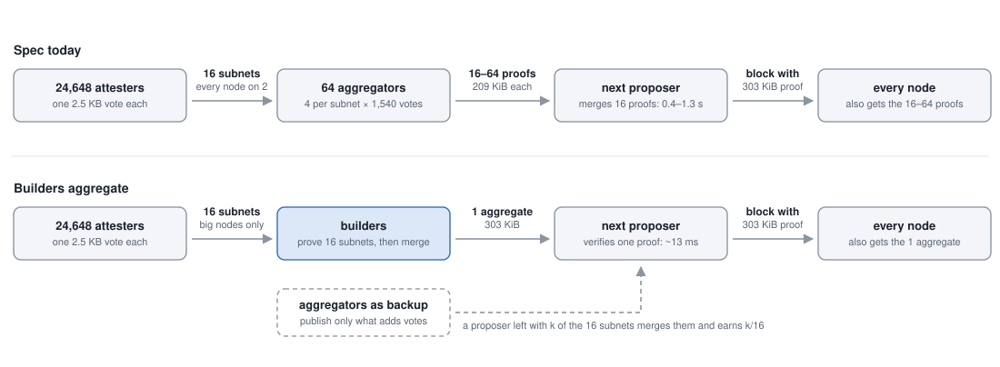

> **Provenance: agent.** The short version is Yann's text of 23 Nov 2026, edited by an agent. The long version is an agent draft of 18–22 Nov. Yann has not reviewed the result line by line.
> - Reward numbers come from [`sim/builder_rewards.py`](sim/builder_rewards.py), the relay arithmetic from [`sim/relay_window.py`](sim/relay_window.py), the figures from [`sim/builders_timeline.py`](sim/builders_timeline.py) and [`sim/builders_flow.py`](sim/builders_flow.py).
> - Spec references are to the consensus-specs `pq` branch @ `ee867e9` (2026-11-17), described in [design.md](design.md).
> - Market numbers are mainnet, 7 days to 2026-11-18: 46,784 MEV-Boost blocks from the relay data APIs, stake from the beacon API.
> - Network times are from Anton Nashatyrev's simulation at 1M validators, proving times from leanVM's benchmarks @ `29077b733`.

# Emergency PQ Consensus Could Rely on Builders

**Context.** We are exploring PQ Gasper as a way to get to PQAI as soon as possible. Networking is the hard part. There are [several avenues that could make PQ Gasper work](https://notes.ethereum.org/_rGnW7YuRWurwyA8zFhsog), but I believe most of them are either unrealistic or come with harsh consequences. This post explores one of them: low-bandwidth nodes rely on builders. In an emergency, that is perhaps not as outlandish as it seems at first glance.

> **Disclaimer.** This write-up does not mean that I believe this is the right path forward. It is an exploration, since the idea has been brought up semi-seriously a couple of times.

**Main idea.** We keep a very simple regular path for attestation aggregation, and accept that it may not let EIP-7870 nodes obtain a full aggregate in time by themselves. For the duration of a single fork, low-bandwidth nodes that want the full attestation reward can rely on builders. To keep fork choice safe, someone other than the next proposer also publishes each slot's votes: builders in the simple version, recent proposers in the principled one.

## Why

1. **It has to last one fork only.** This post assumes PQ-DC follows one fork after PQ Gasper. [ACDC #191](https://forkcast.org/calls/acdc/191) left that choice open and framed PQ Gasper as the quick-deploy fallback.
2. **No large networking change means emergency PQ consensus is ready sooner.** Shipping intermediate solutions is a core ethos of Ethereum, and it is still unclear how much the networking layer has to change.
3. **It frees up capacity to design the stack from the ground up.**
4. **We already rely on builders.**
   - Last week 93.1 % of blocks came through MEV-Boost, and ePBS keeps that choice.
   - A local block earned a median 0.004 ETH in priority fees, against a median builder payment of 0.0089 ETH. In 2024 the gap was 0.0076 against 0.038 ETH ([Toni's post](https://ethresear.ch/t/is-it-worth-using-mev-boost/19753)).
5. **The aggregate is the most valuable thing in most blocks.** If the network becomes unstable, this structure might emerge on its own.
   - Including one slot's votes pays the proposer 0.051 ETH: 0.013 for head votes, 0.013 for source and 0.024 for target.
   - **95 % of winning bids are below that.** Head credit alone, which needs the aggregate in the very next block, beats 71 % of them.
6. **The roles already exist.** Under ePBS builders are staked protocol participants, and the state transition already accepts an attestation proof from anyone.
7. **Nobody has to use a builder.** A proposer includes whatever the regular path gives it.
8. **Incentives line up.** A builder wants its payload to stay on chain, and every later vote adds weight to its block.

## Why not

- **Enshrining** something we do not want long term.
- **Distraction** from redesigning the networking stack, which is the valuable long-term work.

## The design

### Regular path

- **16 attestation subnets**, each with a committee of about 1,600 per slot. One costs roughly 10–35 Mbit/s of download averaged over a slot ([Anton's simulation](https://github.com/Nashatyrev/jvm-libp2p/blob/pq-gasper/pq-gasper-mesh-degree.md), 1M validators). Low-bandwidth nodes join none and only publish their own vote.
- **16 aggregation subnets.** Each subnet's aggregators prove their committee's votes (209 KiB).
- **1 global aggregation topic.** Global aggregators merge the 16 proofs into one full-slot aggregate (303 KiB).
- **A node follows what its machine allows.** The global topic alone is cheapest. The aggregation subnets add a merge of 0.4–1.3 s. The attestation subnets are the most expensive, on both bandwidth and CPU.
- **A proposer includes the best aggregate it has.** A block carries a single proof, so two subnets' proofs have to be merged first.

By my arithmetic from Anton's per-hop times, the full-slot aggregate of this path reaches the last home node at about 11.5–12.5 s. That is too late to be sure of the next block, and it is the gap the rest of the design fills.

### The problem: the next proposer

The above alone is not safe. The proposer of slot N+1 could orphan block N by building on N−1 and leaving out the votes for N. Its block carries a 40 % boost, and a node that has not seen slot N's votes weighs block N at nothing.

So slot N's votes have to reach every node before block N+1 does, from someone other than that proposer. Votes from over 40 % of the slot's stake are enough, so 7 to 10 of the 16 subnets. The two options differ in who may publish them.

### Option 1, naive: builders publish

- Builders sit on all 16 attestation subnets, prove the whole slot and publish a full-slot aggregate. They also hand it to the next proposer next to their bid.
- Nodes that are not on enough subnets themselves rely on these aggregates.
- Builders have their proof by about 6 s, so nodes have 6 s to fetch it. Even 3 s at 20 Mbit/s is room for 8–10 aggregates with duplicate copies.

**For:** it is simple. Builders build 93 % of blocks and do not want theirs orphaned, so at least one should want to share a full aggregate.

**Against:**
- It needs one honest, reachable builder, and there are few: three builders make 83 % of MEV-Boost blocks. Colluding builders can withhold votes, orphan honest blocks and stall justification. They cannot finalize conflicting blocks.
- A self-built block has no builder to speak for it. Where the regular path is late, the next proposer can orphan it at a net cost of about 0.013 ETH.
- A builder that regrets its bid wants its own block orphaned.

### Option 2, principled: recent proposers publish

- The proposers of the last W slots, say W = 8, may each publish one aggregate per slot.
- Every later vote adds weight to their own block, so they want the votes known.
- The set is small and staked, so spam is bounded at W aggregates per slot: 2.4 MiB for W = 8, against the 13.1 MiB today's spec allows.
- We assume an honest proposer in such a window anyway.

**What it guarantees:**
- In a simplified model where every validator votes every slot, it is machine-checked in Lean (not yet published): an honest block is never reorged if one proposer among the last W is honest and can aggregate.
- With 1/32 committees there is only arithmetic so far. With W = 8, an attacker with 20 % of the stake needs 32 proposers in a row to mislead a committee, and one with a third needs 16.

**Against:**
- A relay has to hold the raw votes and prove them: roughly a 32-core server for a whole slot, or a strong desktop for half the subnets. Partial aggregates add up.
- The relays are a public list of at most W validators, which can be flooded.
- It needs three rule changes: fork choice counts only relayed votes, gossip forwards every permitted aggregate that adds a vote, and attesters freeze their view before the slot. With the freeze, this is view-merge in which past proposers also speak.

### What changes

- A global topic for full-slot aggregates with a restricted sender set: staked builders in option 1, the last W proposers in option 2.
- Small nodes stop subscribing to attestation subnets.
- Option 2 adds the three rules above.
- The state transition does not change.

## Q&A

**Does the aggregate ride in the bid?** No, next to it. Bids are re-gossiped each time they rise and have no room for a 303 KiB proof. It should not be bound to the bid either, or a staker with 18 % of the stake could feed its votes only to its own builder and start every auction a median bid ahead.

**Can a builder censor votes?** Not in bulk: leaving out 10 % of a slot costs the proposer 0.005 ETH against any aggregate that has those votes. A single 32 ETH vote is worth only 1,173 gwei, so what protects it is that anyone's aggregate counts.

**What if every builder is down?** The regular path remains. Some subnets miss the next block and lose head credit. Finality continues, because target votes have until the end of the next epoch.

**Why not EIP-8292's super-aggregators?** It is the same role. [EIP-8292](https://eips.ethereum.org/EIPS/eip-8292) asks nodes with 32 ETH per subnet to aggregate every subnet, unpaid, and leaves incentives open. Builders already exist, are staked, and have their own block to protect.

More questions, the timelines and the sources are in the long version below.

---

# Long version

## Regular path, notes

- **What each level costs.**
  - Global topic: one 303 KiB proof and a check of about 13 ms.
  - Aggregation subnets: 16 proofs of 209 KiB, and a merge of 0.37–1.33 s, 5 s on a cheap VPS.
  - Attestation subnets: 441–863 MB of votes per slot for all 16, and a proof of 0.24–1.1 s per subnet.
- **Difference from the `pq` spec.** The spec today has no aggregation subnets. Its subnet proofs go straight to one global topic, and the proposer merges them.
- **Sizes.** 209 KiB and 303 KiB are leanVM's proof sizes for 1,400 signatures per subnet. They are the proof alone. On the wire an aggregate also carries one bit per committee member (0.2 KiB for a subnet, 3 KiB for a full slot) and the sender's 2.4 KiB signature.
- **Vote privacy is unchanged.** A validator that is not an aggregator already publishes through peers on a subnet it does not subscribe to (`specs/phase0/validator.md:356`).
- **One fork.** The last two forks were 7 and more than 11 months apart.

## Option 1 in detail

- **Builders** join all 16 vote subnets, prove them in parallel, merge, and publish one 303 KiB aggregate proof for the slot on a global topic. They also hand it to the next proposer next to their bid.
- **Proposers** include the most complete aggregate they have, from anyone. They verify one proof, about 13 ms in Anton's measurements, instead of merging 16.
- **Everyone else** leaves the vote-subnet backbone, publishes its own vote, and receives a builder's aggregate instead of 16–64 subnet proofs.
- **Fallback.** The spec's four aggregators per subnet stay.
  - They hold their proof until a second deadline, for example 7 s, which still lets it reach the last node before the next block. They publish it if it adds votes to the best aggregate seen, or if none has arrived.
  - A proposer left with proofs for only k of the 16 subnets merges them and earns k/16 of the reward: 0.0063 ETH for two.
- **Spec changes.**
  - A global topic for full-slot aggregates, signed by a staked builder, with the spec's two forwarding rules: more attesting balance during the slot, new votes after it.
  - The aggregators' second deadline.
  - Nodes below a stake threshold stop subscribing to vote subnets.
  - The state transition does not change: `process_stark` only checks that the proof covers the block's attestations.

| Per slot | Spec today | Builders aggregate |
|---|---|---|
| Vote subnets on a home node | 2 of 16: 73–128 MB in | none: it sends its own 2.5 KB vote |
| Aggregate proofs every node downloads and verifies | 16–64 of 209 KiB | one of 303 KiB per builder that improves on the last, plus any that add votes |
| Proving by the proposer | merge 16 → 1: 0.37–1.33 s, 5 s on a cheap VPS | none, if it includes the builder's proof as it is |
| Who has to be well provisioned | the slot's 64 aggregators and its proposer | a few builders, with the 64 aggregators as backup |

## Option 2 in detail

- **Rule.** For each slot, the proposers of the last W slots may each publish one aggregate of that slot's votes on the global topic. Gossip forwards an aggregate from a permitted sender if it adds votes to what the node already holds. Fork choice counts only votes that arrived this way or in a block.
- **Why not let anyone publish.** An open fallback is a spam vector. If each forwarded aggregate had to add 5 % of a committee, an attacker on the subnets could force about 20 proofs per committee per slot, 65 MiB, with no stake at risk.
- **Machine-checked in Lean, on a simplified model.** Every validator votes every slot, latest votes never expire, and attesters merge the proposer's view. The project is not yet published.
  - A block is under every honest head forever once the votes of an honest majority for it are known to all. Nothing is assumed about any other slot.
  - So an honest block is never reorged if one proposer among the last W slots is honest and can aggregate. Its own proposer need not aggregate.
  - With no relay and an adversarial next proposer, the block is reorged.
  - The same design fails with votes that expire after one slot, as in Goldfish.
- **With 1/32 committees, arithmetic only** ([`sim/relay_window.py`](sim/relay_window.py)). One committee votes per slot and a new block carries a 40 % boost. The table gives the adversarial proposers needed in a row after an honest block whose proposer can aggregate.

  | Adversarial stake | W = 1 | W = 2 | W = 4 | W = 8 |
  |---|---:|---:|---:|---:|
  | 20 % | 4 | 8 | 16 | 32 |
  | 25 % | 3 | 6 | 12 | 24 |
  | One third | 2 | 4 | 8 | 16 |

  - W = 1 means that only the block's own proposer relays.
  - Below one third, the block returns once an honest proposer reveals the hidden votes.
  - With every honest vote visible, as today, the attack never works below half the stake.
- **What a relay needs** (estimates from the leanVM benchmarks and Anton's simulation).
  - Whole slot: 441–863 MB of votes in per slot, about 1.4 s of proving on a 32-core server, and 55–85 GB of RAM for 16 proofs in parallel.
  - A strong desktop (16 cores, 64 GB, gigabit) covers about half the subnets in time.
  - Partial aggregates add up, and half the subnets is about what protection against the boost needs.
- **Window size.** Back to the last finalized block would be 64 to 96 slots. Eight is enough by the table, and bounds the extra traffic at 2.4 MiB per slot.

## Timelines

- **Scale.** Network times are Anton's, at 1M validators and mesh degree 8. Today's 789k validators and degree 4 are a little faster.
- **Spec, fast case.** Everything is done by 7 s.
- **Spec, slow case.**
  - An aggregator on a 100/50 home link has its votes at 6.7 s and misses the 6 s deadline.
  - A home proposer finishes its merge at 11.9 s.
- **Builders.**
  - They have the votes by 3.8–4.4 s. Proving takes 0.6 s on 16 servers and 1.4 s on one, so the proof is at the proposer by 4.6–6.0 s.
  - The spare time goes to late votes, which today's 6 s deadline drops.
- **Unchanged.** The block still carries the 303 KiB proof. At today's release times it needs 0.9–3.3 s to reach attesters, who vote at 3 s. The upper end extrapolates [ethPandaOps' fit](https://investigations.ethpandaops.io/2026-05/block-size-vs-propagation/) beyond its largest bin of 224 KB.

## Q&A, complete

**Does the aggregate travel with the bid?**
- Next to it, not inside it. Gloas gossips every higher bid, and the PQ bid bound of 199,240 B has no room for a 303 KiB proof.
- Timing is not a problem. Builders have every vote by about 4.4 s, and bids keep rising until 12 s.
- It should not be bound to the bid either.
  - An aggregate missing 18 % of the slot's votes costs the proposer as much as the whole median bid.
  - So a staker with 18 % of the stake that gives its votes only to its own builder would start every auction a median bid ahead ([Barnabé Monnot, 2022](https://ethresear.ch/t/burning-mev-through-block-proposer-auctions/14029/8)). Its price is 0.0165 ETH of lost head credit in each slot that builder still loses.
- Unbound, the proposer takes the best aggregate from anyone, and nobody gains by hoarding votes.

**Could the proof be revealed with the payload instead?**
- As a second channel, yes. The block carries the attestation bits and the payload envelope carries the proof. The next block applies them if the payload arrived, as Gloas does for execution requests.
- It buys two things.
  - The 303 KiB move from the beacon block to the builder, who has the bandwidth. The block is the hop that runs out of time in the slow case.
  - A withheld aggregate becomes a withheld payload, which ePBS already charges for.
- It costs three.
  - Head credit has to be judged at the bid's slot, not at the slot that applies the votes.
  - Votes committed in an epoch's last block land after epoch processing.
  - What the chain counts depends on the builder releasing the envelope, so the proposer's own inclusion path has to stay.

**What is a vote worth?**
- An attester earns `base reward × weight / 64` per flag, and the proposer that includes the vote earns 1/7 of that. With 44.2M ETH staked, a 32 ETH vote is worth 1,173 gwei to the proposer and a 2,048 ETH vote 75,045 gwei.
- Per vote, the value falls with the square root of total stake. Per slot, it grows with it.
- A vote included one slot late loses head credit, 26 % of its value. After five slots it also loses source. Target counts until the end of the next epoch.

**Can a builder censor votes?**
- In bulk, no. Leaving out 10 % of a slot costs the proposer 0.005 ETH against any aggregate that has those votes.
- For a single validator, price does not help. Its vote is worth 1,173 gwei to the proposer. The attester loses up to 12 times that, if the vote never lands.
- What protects it is that anyone's aggregate counts.
  - Another builder's aggregate may have the vote. So may the proof from its subnet's aggregators, which spreads once it adds a vote.
  - A target vote can land until the end of the next epoch.
- Gloas adds a motive. A withheld payload is still paid for only if votes for its block, from 60 % of the slot's stake, land on chain by the end of the next epoch. A builder that decided which votes land in all of those blocks, up to 63 of them, could keep its own block under that. This is one more reason not to bind the aggregate to the bid.

**Does this hand fork choice to builders?**
- It would if the aggregate went only to the next proposer.
  - A node on no vote subnet sees none of slot N's votes, and a node on two sees an eighth.
  - The proposer of N+1 gets a 40 % boost, so it could reorg block N for such nodes.
- So the votes have to reach every node from someone else, before the next block does. Attesters vote as soon as that block arrives, and it can arrive at 12 s.
  - Votes from over 40 % of the slot's stake are enough, so 7 to 10 of the 16 subnets.
  - One 303 KiB message makes it: the last node has it by 10.4 s in the slow case. Today 16 or more messages do the same job, by about 10.6 s.
- No aggregation design removes this step. Builders shrink it and start it earlier.

**What if every builder is down?**
- The fallback is today's spec on a thinner mesh. The vote subnets then hold the aggregators and the large operators only. In Kamil's model those operators hold 96 % of the stake.
- In its slow case some subnets miss the next block and lose head credit. Finality continues, because target votes have until the end of the next epoch.
- A chain without builders is already a degraded chain.

**Who pays builders to aggregate?**
- The protocol pays nobody, as with aggregators today. The proposer wants the 0.051 ETH, and builders compete for the proposer.
- The proving is cheap. Barnabé Monnot's model prices it at about $45,000 a year for a network-wide DC aggregation tree ([27 Oct call](../../meetings/2026-10-27.md)). The builders' 10 Gbit/s links are the larger cost.
- If that is not enough, the block can name the aggregate's producer and pay it a share.

**Why builders and not EIP-8292's super-aggregators?**
- [EIP-8292](https://eips.ethereum.org/EIPS/eip-8292) asks nodes with 32 ETH per subnet, so 512 ETH here, to aggregate every subnet, unpaid. It leaves the block-level merge to the proposer and lists incentives as open.
- This is the same role with three additions.
  - The builder registry gives it an identity and a stake, which gossip needs against spam. Any pool can register.
  - It includes the merge, so the proposer proves nothing.
  - Block builders will fill it, because they already have a channel to every proposer and a reason to use it.

## Prior art

- **Potuz**, 9 Nov 2026: "Builders could also provide aggregates with their bid as a service" ([post](https://www.potuz.net/posts/pq/)).
- **Potuz**, June 2026, #epbs on the Eth R&D Discord: as a hypothetical, "the future fork where we allow builders to also be post-quantum aggregators", staked with at least 2K ETH.
- **Vitalik Buterin**, [two-slot PBS](https://ethresear.ch/t/two-slot-proposer-builder-separation/10980) (2021): the builder includes "as many attestations … as they can find" and is rewarded for them.
- **EIP-8292** (2026): opt-in super-aggregators, with the merge left to the proposer.

## Open

- **Builders' links and servers.** Anton's pools take in 441–863 MB per slot on 16 subnets, at 1M validators. That needs 10 Gbit/s: on 1 Gbit/s it takes 3.5–7 s to arrive. Proving 16 subnets at once on one server is not benchmarked.
- **A thinner fallback.** With home nodes off the vote subnets, the backup aggregators collect from fewer peers, and a joint failure of the top builders hits every node at once.
- **The proposer's merge.** A proposer that adds anything to the builder's proof has to merge, whether late votes or a subnet's proof. Anton measured 0.22–0.33 s for two proofs.
- **Reliability.** Whether unpaid builders publish every slot, or the producer needs a share.
- **Committees in the proof.** The Lean result covers a full committee only. The 1/32-committee numbers for option 2 are arithmetic.
- **Flooding the relays.** In option 2 the permitted relays are public. How many of them can be flooded for a few seconds is the same question as for the spec's four aggregators per subnet ([aggregator-selection.md](aggregator-selection.md)).
