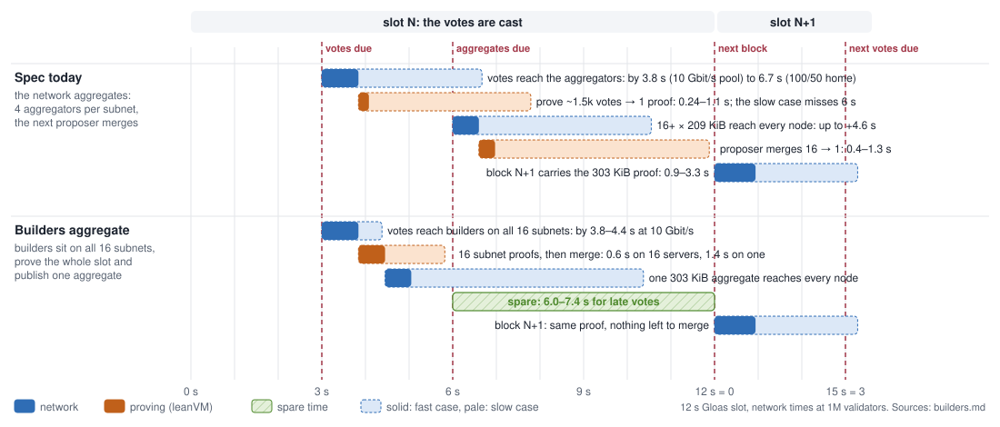

> **Provenance: agent.** Drafted 2026-11-18 by an agent from Yann's dictated argument, as a follow-up to avenue 5 of [README.md](README.md). Yann has not reviewed it line by line.
> - Reward numbers come from [`sim/builder_rewards.py`](sim/builder_rewards.py), the figures from [`sim/builders_timeline.py`](sim/builders_timeline.py) and [`sim/builders_flow.py`](sim/builders_flow.py).
> - Spec references are to the consensus-specs `pq` branch @ `ee867e9` (2026-11-17), described in [design.md](design.md).
> - Market numbers are mainnet, 7 days to 2026-11-18: 46,784 MEV-Boost blocks from the relay data APIs, stake from the beacon API.
> - Network times are from Anton Nashatyrev's simulation at 1M validators, proving times from leanVM's benchmarks @ `29077b733`.

# PQ Gasper through builders

Follow-up to [PQ Gasper: possible avenues](README.md). That list filed "rely on builders to aggregate" as one compromise among nine. This note argues it is the cleanest one.

**Claim.** If PQ Gasper ships as a one-fork bridge to PQ-DC, builders should aggregate its votes. They prove the whole slot and publish one aggregate, and the next proposer includes it. The spec's own aggregation path stays as the fallback.

## Why

1. **It has to last one fork.**
   - [ACDC #191](https://forkcast.org/calls/acdc/191) left the choice between PQ-DC and PQ Gasper open, with PQ Gasper framed as the quick-deploy fallback. If it ships in I\* and PQ-DC follows in J\*, its aggregation design lives for one fork.
   - That rules out a new p2p stack and makes a shortcut acceptable. PQ-DC has four times the votes per slot and should not inherit this one.
2. **The version that fits in 12 s already depends on big machines.**
   - The spec: votes are due at 3 s. Four aggregators per subnet each prove ~1,540 votes and publish at 6 s. The next proposer merges 16 proofs into the 303 KiB proof in its block ([design.md](design.md)).
   - Kamil Salakhiev and Anton Nashatyrev report that their simulations keep 12 s slots. [Anton's](https://github.com/Nashatyrev/jvm-libp2p/blob/pq-gasper/pq-gasper.md) does so, at 1M validators, with 10 Gbit/s pools as aggregators and with 50/25 Mbit/s home nodes off every vote subnet.
   - There is a reason they are off. A node on two vote subnets takes in 73–128 MB per slot ([mesh degree 4–8](https://github.com/Nashatyrev/jvm-libp2p/blob/pq-gasper/pq-gasper-mesh-degree.md)). That averages 49–85 Mbit/s and arrives in bursts. EIP-7870 recommends 50.
   - The proposer stays tight. The last home node has all 16 aggregates 4.6 s after they go out, so at about 10.6 s. The merge then takes 0.37–1.33 s on [leanVM's benchmark machines](https://leanvm.org), which can leave 0.1 s. On Kamil's €50 VPS it takes "5 seconds" (ACDC #191 chat).
   - Potuz: "even 12 seconds may be too short to ship PQ with our current consensus algorithm" ([post](https://www.potuz.net/posts/pq/)). The `pq-dc` spec branch: "The aggregation load of PQ-Gasper looks infeasible within a slot" ([commit](https://github.com/ethereum/consensus-specs/commit/bde2349e1e86763aed845e8a064cb22805628e0c)).
3. **We already rely on builders.**
   - 93.1 % of last week's blocks came through MEV-Boost. [Relayscan](https://www.relayscan.io/overview?t=7d) puts Titan at 53.6 % of those and the top three builders at 83 %.
   - A local block earned a median 0.004 ETH in priority fees and used 8.6M gas. The median builder payment was 0.0089 ETH, for a block of 29.8M gas. In 2024 the gap was 0.0076 against 0.038 ETH ([Toni Wahrstätter](https://ethresear.ch/t/is-it-worth-using-mev-boost/19753)).
   - ePBS (EIP-7732, part of Glamsterdam, now on testnets) makes builders staked protocol participants. Self-building stays possible. Today it is 7 % of blocks.
4. **The aggregate is the most valuable thing in most blocks.**
   - With 44.2M ETH staked, including one slot's votes pays the proposer 0.051 ETH: 0.013 for head votes, 0.013 for source and 0.024 for target.
   - 95 % of winning bids are below that, and the median bid is 0.0089 ETH. Head credit alone, which needs the aggregate in the very next block, beats 71 % of winning bids.
   - The spec's path already delivers this when it runs on time. What builders add is the margin: late votes, slow proposers and missed deadlines, each of which costs head credit.
5. **Builders have the time.** Their proof is at the proposer by 4.6–6.0 s. A home proposer that merges for itself finishes at 11.9 s in the slow case ([figure](#timelines)).

## The design

- **Builders** join all 16 vote subnets, prove them in parallel, merge, and publish one 303 KiB aggregate proof for the slot on a global topic. They also hand it to the next proposer next to their bid.
- **Proposers** include the most complete aggregate they have, from anyone. They verify one proof, about 13 ms in Anton's measurements, instead of merging 16.
- **Everyone else** leaves the vote-subnet backbone, publishes its own vote, and receives a builder's aggregate instead of 16–64 subnet proofs.
- **Fallback.** The spec's four aggregators per subnet stay.
  - They hold their proof until a second deadline, for example 8 s. They publish it if it adds votes to the best aggregate seen, or if none has arrived.
  - A proposer left with proofs for only k of the 16 subnets merges them and earns k/16 of the reward: 0.0063 ETH for two.
- **Spec changes.**
  - A global topic for full-slot aggregates, signed by a staked builder, with the spec's two forwarding rules: more attesting balance during the slot, new votes after it.
  - The aggregators' second deadline.
  - Nodes below a stake threshold stop subscribing to vote subnets.
  - The state transition does not change: `process_stark` only checks that the proof covers the block's attestations.

| Per slot | Spec today | Builders aggregate |
|---|---|---|
| Vote subnets on a home node | 2 of 16: 73–128 MB in | none: it sends its own 2.5 KB vote |
| Aggregate proofs every node downloads and verifies | 16–64 of 209 KiB | one of 303 KiB per builder that improves on the last, plus any that add votes |
| Proving by the proposer | merge 16 → 1: 0.37–1.33 s, 5 s on a cheap VPS | none, if it includes the builder's proof as it is |
| Who has to be well provisioned | the slot's 64 aggregators and its proposer | a few builders, with the 64 aggregators as backup |

## Timelines

- **Scale.** Network times are Anton's, at 1M validators and mesh degree 8. Today's 789k validators and degree 4 are a little faster.
- **Spec, fast case.** Everything is done by 7 s.
- **Spec, slow case.**
  - An aggregator on a 100/50 home link has its votes at 6.7 s and misses the 6 s deadline.
  - A home proposer finishes its merge at 11.9 s.
- **Builders.**
  - They have the votes by 3.8–4.4 s. Proving takes 0.6 s on 16 servers and 1.4 s on one, so the proof is at the proposer by 4.6–6.0 s.
  - The spare time goes to late votes, which today's 6 s deadline drops.
- **Unchanged.** The block still carries the 303 KiB proof. At today's release times it needs 0.9–3.3 s to reach attesters, who vote at 3 s. The upper end extrapolates [ethPandaOps' fit](https://investigations.ethpandaops.io/2026-05/block-size-vs-propagation/) beyond its largest bin of 224 KB.

## Q&A

**Does the aggregate travel with the bid?**
- Next to it, not inside it. Gloas gossips every higher bid, and the PQ bid bound of 199,240 B has no room for a 303 KiB proof.
- Timing is not a problem. Builders have every vote by about 4.4 s, and bids keep rising until 12 s.
- It should not be bound to the bid either.
  - An aggregate missing 18 % of the slot's votes costs the proposer as much as the whole median bid.
  - So a staker with 18 % of the stake that gives its votes only to its own builder would start every auction a median bid ahead ([Barnabé Monnot, 2022](https://ethresear.ch/t/burning-mev-through-block-proposer-auctions/14029/8)). Its price is 0.0165 ETH of lost head credit in each slot that builder still loses.
- Unbound, the proposer takes the best aggregate from anyone, and nobody gains by hoarding votes.

**Could the proof be revealed with the payload instead?**
- As a second channel, yes. The block carries the attestation bits and the payload envelope carries the proof. The next block applies them if the payload arrived, as Gloas does for execution requests.
- It buys two things.
  - The 303 KiB move from the beacon block to the builder, who has the bandwidth. The block is the hop that runs out of time in the slow case.
  - A withheld aggregate becomes a withheld payload, which ePBS already charges for.
- It costs three.
  - Head credit has to be judged at the bid's slot, not at the slot that applies the votes.
  - Votes committed in an epoch's last block land after epoch processing.
  - What the chain counts depends on the builder releasing the envelope, so the proposer's own inclusion path has to stay.

**What is a vote worth?**
- An attester earns `base reward × weight / 64` per flag, and the proposer that includes the vote earns 1/7 of that. With 44.2M ETH staked, a 32 ETH vote is worth 1,173 gwei to the proposer and a 2,048 ETH vote 75,045 gwei.
- Per vote, the value falls with the square root of total stake. Per slot, it grows with it.
- A vote included one slot late loses head credit, 26 % of its value. After five slots it also loses source. Target counts until the end of the next epoch.

**Can a builder censor votes?**
- In bulk, no. Leaving out 10 % of a slot costs the proposer 0.005 ETH against any aggregate that has those votes.
- For a single validator, price does not help. Its vote is worth 1,173 gwei to the proposer. The attester loses up to 12 times that, if the vote never lands.
- What protects it is that anyone's aggregate counts.
  - Another builder's aggregate may have the vote. So may the proof from its subnet's aggregators, which spreads once it adds a vote.
  - A target vote can land until the end of the next epoch.
- Gloas adds a motive. A withheld payload is still paid for only if votes for its block, from 60 % of the slot's stake, land on chain by the end of the next epoch. A builder that decided which votes land in all of those blocks, up to 63 of them, could keep its own block under that. This is one more reason not to bind the aggregate to the bid.

**Does this hand fork choice to builders?**
- It would if the aggregate went only to the next proposer.
  - A node on no vote subnet sees none of slot N's votes, and a node on two sees an eighth.
  - The proposer of N+1 gets a 40 % boost, so it could reorg block N for such nodes.
- So the aggregate has to reach every node before the next votes are due at 15 s. One 303 KiB message has that time. Today 16 or more messages do the same job.

**What if every builder is down?**
- The fallback is today's spec on a thinner mesh. The vote subnets then hold the aggregators and the large operators only. In Kamil's model those operators hold 96 % of the stake.
- In its slow case some subnets miss the next block and lose head credit. Finality continues, because target votes have until the end of the next epoch.
- A chain without builders is already a degraded chain.

**Who pays builders to aggregate?**
- The protocol pays nobody, as with aggregators today. The proposer wants the 0.051 ETH, and builders compete for the proposer.
- The proving is cheap. Barnabé Monnot's model prices it at about $45,000 a year for a network-wide DC aggregation tree ([27 Oct call](../../meetings/2026-10-27.md)). The builders' 10 Gbit/s links are the larger cost.
- If that is not enough, the block can name the aggregate's producer and pay it a share.

**Why builders and not EIP-8292's super-aggregators?**
- [EIP-8292](https://eips.ethereum.org/EIPS/eip-8292) asks nodes with 32 ETH per subnet, so 512 ETH here, to aggregate every subnet, unpaid. It leaves the block-level merge to the proposer and lists incentives as open.
- This is the same role with three additions.
  - The builder registry gives it an identity and a stake, which gossip needs against spam. Any pool can register.
  - It includes the merge, so the proposer proves nothing.
  - Block builders will fill it, because they already have a channel to every proposer and a reason to use it.

## Prior art

- **Potuz**, 9 Nov 2026: "Builders could also provide aggregates with their bid as a service" ([post](https://www.potuz.net/posts/pq/)).
- **Potuz**, June 2026, #epbs on the Eth R&D Discord: as a hypothetical, "the future fork where we allow builders to also be post-quantum aggregators", staked with at least 2K ETH.
- **Vitalik Buterin**, [two-slot PBS](https://ethresear.ch/t/two-slot-proposer-builder-separation/10980) (2021): the builder includes "as many attestations … as they can find" and is rewarded for them.
- **EIP-8292** (2026): opt-in super-aggregators, with the merge left to the proposer.

## Open

- **Builders' links and servers.** Anton's pools take in 441–863 MB per slot on 16 subnets, at 1M validators. That needs 10 Gbit/s: on 1 Gbit/s it takes 3.5–7 s to arrive. Proving 16 subnets at once on one server is not benchmarked.
- **A thinner fallback.** With home nodes off the vote subnets, the backup aggregators collect from fewer peers, and a joint failure of the top builders hits every node at once.
- **Vote privacy.** With home nodes off the subnets, a vote's first hop is a builder or a large operator.
- **The proposer's merge.** A proposer that adds anything to the builder's proof has to merge, whether late votes or a subnet's proof. Anton measured 0.22–0.33 s for two proofs.
- **Reliability.** Whether unpaid builders publish every slot, or the producer needs a share.
