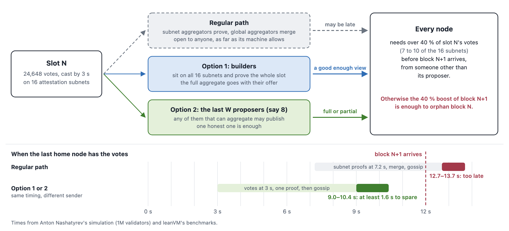

# Emergency PQ Consensus Could Rely on Builders

**Context.** We are exploring PQ Gasper as a way to get to [PQAI](https://ethlabs.org/writings/pqai27.html) as soon as possible. Networking is the hard part. There are [several avenues that could make PQ Gasper work](https://notes.ethereum.org/_rGnW7YuRWurwyA8zFhsog), but I believe most of them are either unrealistic or come with harsh consequences. This post explores one of them: [EIP-7870](https://eips.ethereum.org/EIPS/eip-7870) nodes rely on builders. In an emergency, that is perhaps not as outlandish as it seems at first glance.

> **Disclaimer.** This write-up does not mean that I believe this is the right path forward. It is an exploration, since the idea has been brought up semi-seriously a couple of times, in discussions (by myself and others), and in writing [\[1\]](https://www.potuz.net/posts/pq/), [\[2\]](https://ethresear.ch/t/two-slot-proposer-builder-separation/10980).

**Main idea.** We keep a very simple regular path for attestation aggregation, and accept that it may not get a slot's votes to EIP-7870 nodes before the next block. Rewards do not suffer, because a block includes the votes cast two slots before it, so the bottleneck is vote dissemination for fork-choice safety. For the duration of a single fork (until PQ-DC ships), proposers of the previous slots act as aggregators, and get the right to disseminate a global aggregate. Proposers on EIP-7870 nodes rely on builders, who are incentivized to share aggregates too, as they have their MEV rewards at stake.

## Why

1. **It has to last one fork only.** This post assumes PQ-DC would follow one fork after PQ Gasper. PQ Gasper itself is more the emergency fallback than the best case.
2. **No large networking change means emergency PQ consensus is ready sooner.** Shipping intermediate solutions is a core ethos of Ethereum, and it is still unclear how much the networking layer has to change.
3. **It frees up capacity to design the networking stack from the ground up.**
4. **We already rely on builders.**
   - In the week to 18 November, 93.1 % of blocks came through MEV-Boost, and ePBS won't change that.
   - A local block earned a median 0.004 ETH in priority fees, against a median builder payment of 0.0089 ETH. In 2024 the gap was 0.0076 against 0.038 ETH ([Toni's post](https://ethresear.ch/t/is-it-worth-using-mev-boost/19753)).
5. **The aggregate is the most valuable thing in most blocks, which makes a block worth protecting.**
   - Including one slot's votes pays the proposer 0.051 ETH: 0.0131 for head votes, 0.0131 for source and 0.0244 for target. **95 % of winning bids are below that.**
   - A proposer whose block is orphaned loses that and the bid, about 0.06 ETH at the median. Its builder loses the payload.
   - The proposer does not have to buy the aggregate: the regular path delivers it about 10 s before its slot. If the network becomes unstable and that fails, the aggregate goes into the builder's offer, and this structure might emerge on its own.
6. **The roles and architecture already exist.** Under ePBS builders are staked protocol participants, and the state transition already accepts an attestation proof from anyone.
7. **Nobody has to use a builder.** A proposer includes the best aggregate it sees. EIP-7870 nodes might only have access to fewer subnets, or a limited number of global aggregates, but especially with two-slot delay that is not the bottleneck.
8. **Incentives line up.** A builder wants its payload to stay on chain, and a proposer wants its reward. Every later vote adds weight to their block, so they want the votes seen.

## Why not

- **Enshrining** something we probably do not want long term.
- **Distraction** from redesigning the networking stack, which is the valuable long-term work.

## The design

- **16 attestation subnets**, each with a committee of about 1,500 per slot. One costs roughly 10–35 Mbit/s of download averaged over a slot ([Anton's simulation](https://github.com/Nashatyrev/jvm-libp2p/blob/pq-gasper/pq-gasper-mesh-degree.md), 1M validators). EIP-7870 nodes join none and only publish their own vote.
- **16 aggregation subnets.** Each subnet's aggregators prove their committee's votes (209 KiB).
- **1 global aggregation topic.** Global aggregators merge the 16 proofs into one full-slot aggregate (303 KiB).
- **A node follows what its machine allows.** The global topic alone is cheapest. The aggregation subnets add a merge of 0.4–1.3 s. The attestation subnets are the most expensive, on both bandwidth and CPU.
- **A proposer includes the best aggregate it has.**

By current simulations (devnets to come), this PQ aggregation topology seems not performant enough to serve EIP-7870 nodes.
The rest of the design explores how they could receive enough attestations in time.

### The problem: fork-choice safety

One problem with not obtaining attestations in time is that the proposer of slot N+1 could orphan block N by building on N−1. Its block carries a boost worth 40 % of one slot's stake, and a node that has not seen slot N's votes weighs block N at nothing.

So slot N's votes have to reach every node before block N+1 does.

### Suggested solution: lightweight global topic with only recent proposers publishing

- The proposers of the last W slots, say W = 8, may each publish one aggregate per slot, in a new lightweight global topic, specifically for EIP-7870 nodes.

**Why it could work:**
- We assume an honest proposer in such a window anyway, under synchrony they (or their builder) will see all votes, and propagate them.
- In the good case, the incentives align: every later vote adds weight to a proposer's block, so they want the votes known.
- A proposer need not make the proof itself. Its builder has the servers and the same block to protect, and a proof is valid whoever made it.
- The set is small and staked, so spam is bounded at W aggregates per slot: 2.4 MiB for W = 8, against the 13.1 MiB today's spec allows for the global topic.
- With a builder's links and servers the proof is ready by about 6 s, so nodes have 6 s to fetch it. Even 3 s at 20 Mbit/s is room for 8–10 aggregates with duplicate copies.

**What it guarantees:**
- An honest block is never reorged if one proposer among the last W is honest and can aggregate.

**Where it could go wrong:**
- Under long periods of asynchrony above W the arguments don't really hold anymore, and it's unclear if this design could make recovering from asynchrony harder.

### What changes

- A global topic for full-slot aggregates with a restricted sender set: the proposers of the last W slots.
- EIP-7870 nodes stop subscribing to attestation subnets.

## Q&A

**What about the version without delayed inclusion?** The two-slot inclusion delay is the current choice of the `pq` spec, not a given. The version without it is also very achievable in this model. The proposer needs the aggregate earlier, but could obtain it from a builder at the same time as the payload. Builders can also advertise how good their aggregate is through their bids. This gives an extra incentive to builders to participate in aggregations.
Aggregations today would be more valuable on average than the payload itself.

**Why not let builders publish directly?** That is the naive version, and it has some issues. The set of staked builders is open-ended, so the topic could be spammed to keep votes from arriving in time. It also needs one honest, reachable builder, and a self-built block has nobody to speak for it.

**What if every builder is down?** Proposers that can aggregate by themselves still publish. Where none in the window can, the regular path remains. With the spec's two-slot inclusion delay the rewards hold up, and finality continues. What is lost is the early view: the slowest nodes see a slot's votes only after the next block.

**Why not EIP-8292's super-aggregators?** It is the same role. [EIP-8292](https://eips.ethereum.org/EIPS/eip-8292) asks nodes with 32 ETH per subnet to aggregate every subnet, unpaid, and leaves incentives open. Recent proposers and their builders already exist, are staked, and have their own block to protect.

Of course there are still open questions, so feedback is welcome!
