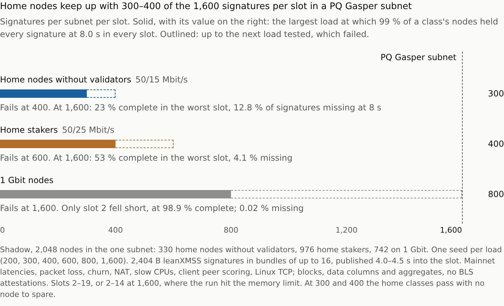
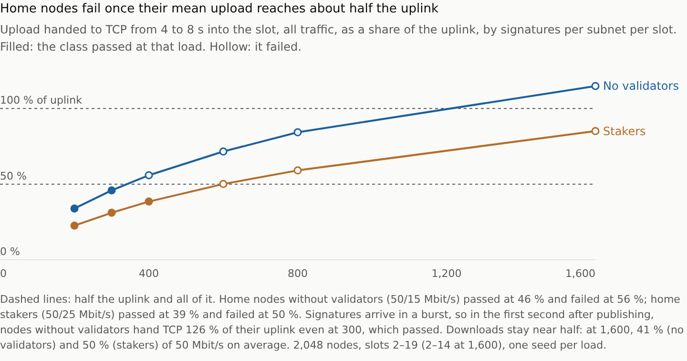

# Can PQ Gasper run on gossipsub?

*Draft of* 2026-11-23*.*

**Not at 1,600 signatures per subnet.** With 800k validators, PQ Gasper sends 25,000 signatures per slot, about 1,600 in each of 16 subnets. We simulated one such subnet in Shadow on 2,048 nodes, with home bandwidth, packet loss and churn. In the worst slot, only 23 % of home nodes without validators and 53 % of home stakers had every signature 4 s after publishing began. Gossipsub delivered to every class up to 300 signatures per subnet per slot; beyond that, forwarding fills home uplinks.

## Gasper is the easier change, if gossipsub can carry it

Ethlabs calls PQ Gasper versus PQ decoupled consensus "the biggest open question" for [pqai27](https://ethlabs.org/writings/pqai27.html): Gasper is "plausibly the easier change", but "it is less clear how many compromises that takes". [Potuz](https://www.potuz.net/posts/pq/) wants PQ Gasper first and names the test: "We need POCs on the CL right now to see whether gossipsub is even viable". If Gasper needs new slot or epoch parameters, he would rather move to decoupled consensus.

## A Gasper subnet is four to five times what home nodes can carry

- **Nodes:** 2,048, all in the one subnet, with mainnet's validator distribution. 742 are on 1 Gbit, 976 are home stakers on 50/25 Mbit/s and 330 are home nodes without validators on 50/15 Mbit/s (EIP-7870).
- **Load:** 2,404 B leanXMSS signatures in bundles of up to 16, published 4.0–4.5 s into the slot. Every node must hold all of them at 8.0 s, when aggregation starts. Blocks, data columns and aggregates run alongside; BLS attestations don't, since PQ Gasper replaces them.
- **Network:** mainnet latencies, packet loss, churn, NAT, slow CPUs, each client's peer scoring and Linux TCP.
- **Pass:** at least 99 % of each class's nodes complete in every slot.

## Home nodes fail once forwarding takes about half their uplink

- Every node in a subnet's mesh forwards each signature to its mesh peers. At 1,600, a home node without validators hands TCP 115 % of its uplink over 4–8 s on average, and 171 % at the busiest node. A home staker hands it 85 %, and 140 %. Downloads average 41 % and 50 % of the link.
- With the uplink full, the node's ACKs and IWANT requests queue behind its forwards. Paths into it see 16 to 31 times as many TCP timeouts as paths into a home node that doesn't forward, and peers drop forwards that wait more than 1 s.
- In a diagnostic run where 30 % of nodes never forward (512 nodes at 1,600), home nodes that don't forward miss 3 to 8 times fewer signatures: 2.2 % against 17.3 % without validators, and 2.0 % against 6.6 % for stakers.

## No single setting rescues 1,600

- **More 1 Gbit nodes:** with 80 % of nodes on 1 Gbit, the home nodes' worst slots stay at 23 % and 53 %, though they miss about 40 % fewer signatures.
- **Smaller signatures:** 800 signatures of 2.4 kB, the same bytes as 1,600 of Potuz's 1.2 kB option, fail both home classes (78 % and 91 % complete in the worst slot). The 1.2 kB option also sends more messages, so it would fail by slightly more.
- **A cleaner network:** without packet loss, churn, NAT and slow CPUs, or without TCP slow start after idle, home nodes without validators pass at 400, only just.
- **Running today's BLS attestations alongside** turns the pass at 300 into a fail, by one node.

## What PQ Gasper on gossipsub would need

- **About 300 signatures per subnet per slot.** At 25,000 per slot that is about 80 subnets, five times leanVM's 16, so five times as many aggregates to merge. If home nodes keep joining two backbone subnets as today, the budget per subnet nearly halves. With 16 subnets, it means consolidating to about 150k validators.
- **Or home nodes outside the subnet meshes.** They would publish their own signatures without forwarding others', and fast nodes would carry the subnets and aggregate. With 80 % of nodes on 1 Gbit, the 1 Gbit nodes passed 1,600 (99.8 % in the worst slot). How many fast nodes mainnet has, and how many subnets each could carry, is untested.
- **Or decoupled consensus.** Only a 512-member committee votes on the chain's critical path. Finality votes still come from the full validator set, in 4 s units sized like today's attestation slot ([dc-networking](https://github.com/ethereum/dc-networking)), so the same per-subnet limit applies, though a late vote only delays finality.

## Caveats

- One seed per load. At 300 and 400 the two home classes pass with no node to spare.
- 2,048 nodes is the largest network that fits the simulation machine, and the 1,600 run stopped after slot 14 at its memory limit. Mainnet has several times more nodes; at 400, 512 nodes gave the same verdict as 2,048.
- Each node joins one subnet, and aggregation is not simulated. leanVM aggregates 1,400 signatures in 0.4–1.6 s and merges 16 aggregates in another 0.4–1.7 s on 8- to 32-core machines.
- The 1 Gbit share is an assumption: every node with more than 8 validators and a fifth of the rest.
- [Barnabé Monnot's aggregation model](https://github.com/barnabemonnot/pq-aggregation-model) assumes 2 copies of each signature per node; our earlier runs measured 4 to 5.
