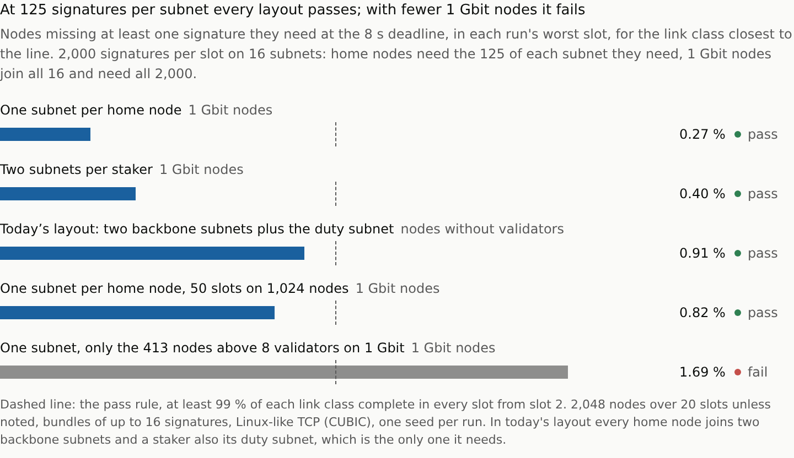
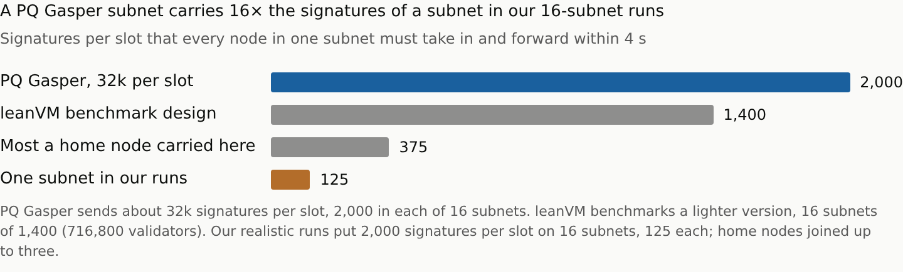
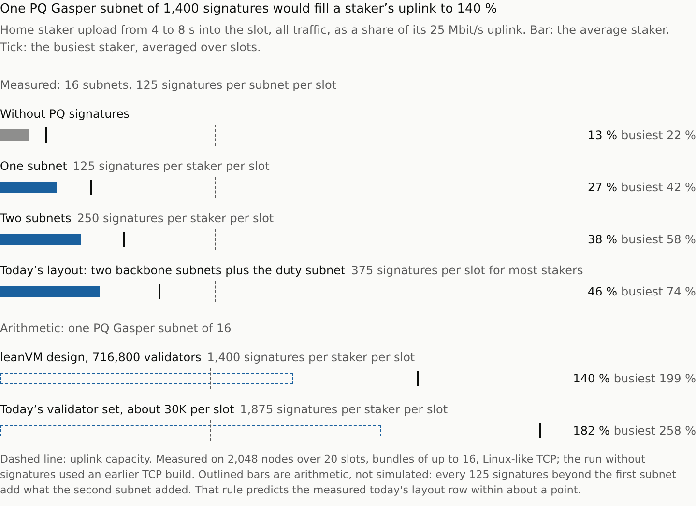

# Can PQ Gasper run on gossipsub?

*Draft of 2026-11-12, with every planned run in.*

**Possibly, but not with today's subnet layout.** In a Shadow simulation of 2,048 mainnet-like nodes, unmodified gossipsub delivers 2,000 post-quantum signatures per slot within 4 s in every subnet layout we tried. Today's layout passes too, with no node to spare. PQ Gasper sends 30K per slot, 15 times as many. At the measured cost of a subnet, a staker's uplink then has room for one subnet out of 64 but not today's three, and nodes in every subnet would carry 15 times the traffic. Neither has been simulated.

## Gasper is the easier change, if gossipsub can carry it

Ethlabs calls PQ Gasper versus PQ decoupled consensus "the biggest open question" for [pqai27](https://ethlabs.org/writings/pqai27.html): Gasper is "plausibly the easier change", but "it is less clear how many compromises that takes". [Potuz](https://www.potuz.net/posts/pq/) wants PQ Gasper shipped first and sets the test: Gasper broadcasts 30K attestations per slot, now with 2 KB or 1.2 KB signatures, and "we need POCs on the CL right now to see whether gossipsub is even viable". If Gasper needs new slot or epoch parameters, he would rather move to decoupled consensus.

## What we simulated

- 2,048 nodes in Shadow, with mainnet's validator distribution and client mix, measured latencies, packet loss and churn, and TCP patched to behave like Linux (CUBIC).
- Links: EIP-7870 home links (50/25 Mbit/s with validators, 50/15 without), and 1 Gbit for every node with more than 8 validators plus a fifth of the rest, 742 nodes in all.
- Load: 2,000 signatures of 2.4 kB per slot, sent 4.0–4.5 s into the slot on 16 subnets, in bundles of up to 16 per node. Today's BLS traffic runs alongside.
- Gossipsub with each client's default parameters and scoring.
- Pass rule: from slot 2, in every slot, at least 99 % of each link class holds every signature it needs at 8 s. A 1 Gbit node joins all 16 subnets and needs all 2,000 signatures; a home node needs the 125 of each subnet assigned to it.

## At 2,000 signatures per slot, every layout passes

- One subnet per home node passes with margin: in the worst slot 2 of 742 1 Gbit nodes are incomplete, where the rule allows 7. Over 50 slots on 1,024 nodes it passes too, with no node to spare in one slot.
- Two subnets per staker also pass with margin: 3 of 742 in the worst slot, and every home node holds every signature it needs in every slot.
- Today's layout passes with no node to spare. Every home node joins two backbone subnets, and a staker also its duty subnet, the only one it needs. Nodes without validators, on 15 Mbit/s uplinks, become the tightest class: 3 of 330 miss a signature in slot 2, where the rule allows 3, and the busiest uses 90 % of its uplink while signatures spread. Home p99 latency nears 1 s, against 0.6 s with one subnet.
- The other misses fall on 1 Gbit nodes far from most of their peers. With only the 413 nodes above 8 validators on 1 Gbit, one subnet per home node fails.
- One subnet per node does not mean one validator per node: all of a home node's validators (up to 8) sign into its one subnet.

## At Gasper's 30K, a staker's uplink has room for one subnet of 64

What 15 times the signatures does to a home staker depends on how many subnets share them, and how many of those the staker joins.

- Each subnet costs a staker 11–13 % of its uplink on average while signatures spread, and the busiest staker 15–21 %. Adding that cost per subnet predicts today's layout here within a point: 47 % and 73 %, against 46 % and 74 % measured.
- Gasper's 30K per slot over today's 64 subnets is about 470 per subnet. At the same cost, one such subnet puts the average staker at 57 % of its uplink and the busiest at 85 %; today's three put them at 140 % and 200 %. Over the 16 subnets we simulated, even one subnet would exceed the uplink.
- Nodes without validators have less room: one subnet of 64 would put them at 88 % of their 15 Mbit/s uplink on average, so they could not join one.
- Nodes in every subnet would carry 15 times the signatures they carried here, about two thirds of a 1 Gbit uplink on average. In four of the five runs, these nodes came closest to failing.
- Every number shrinks in proportion as validators consolidate. At 768k validators, one subnet of 64 carries 375 signatures per slot, the load stakers carried in today's layout here; nodes in every subnet would still carry 12 times what they carried here.

## Decoupled consensus moves the load off the critical path

Decoupled consensus leaves only a 512-member head committee on the critical path, a quarter of the load that passed here. Its finality votes still come from the full validator set, and one design under study sends them in 4 s units sized like today's attestation slot ([dc-networking](https://github.com/ethereum/dc-networking)). The same arithmetic applies to them, but a late finality vote delays finality, not the chain.

## Caveats

- One seed per run, 20 slots (one run of 50), on 2,048 nodes; mainnet has several times more.
- The 30K figures assume upload grows linearly with the signatures a node carries. That held from one to three subnets, but 30K is far beyond what we measured.
- Aggregation is not simulated. The 300 kB proofs that must reach the proposer and the 2–3 s final recursion come on top.
- The 1 Gbit share is an assumption, and the verdict depends on it.
- The rule is strict: in the passing runs, 1 Gbit nodes missed at most 0.003 % of PQ messages at the deadline, against 1.2–1.8 % of BLS attestations.
