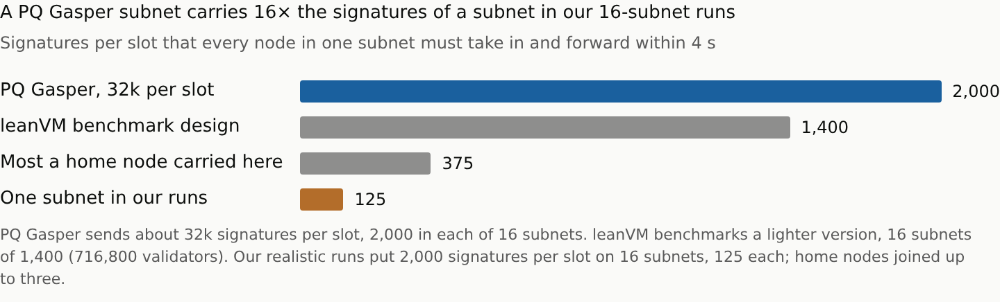
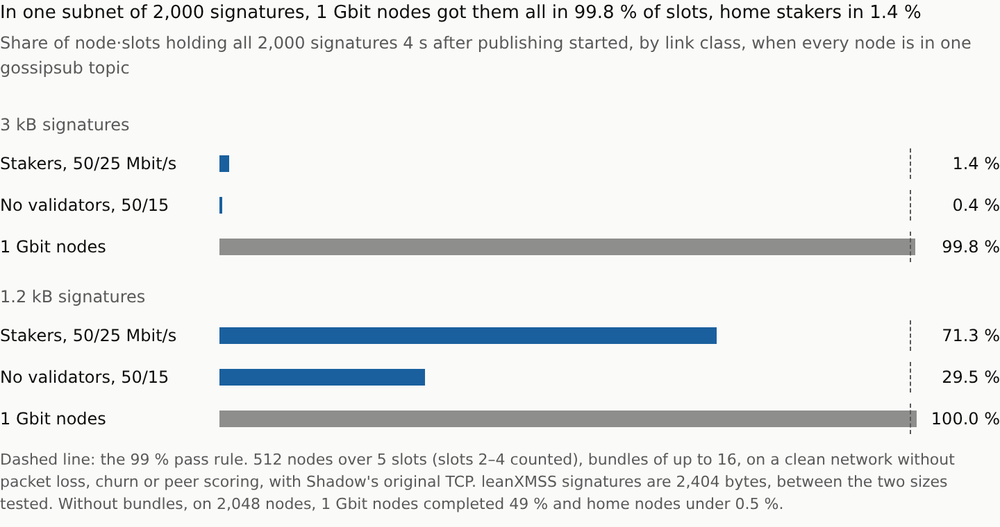
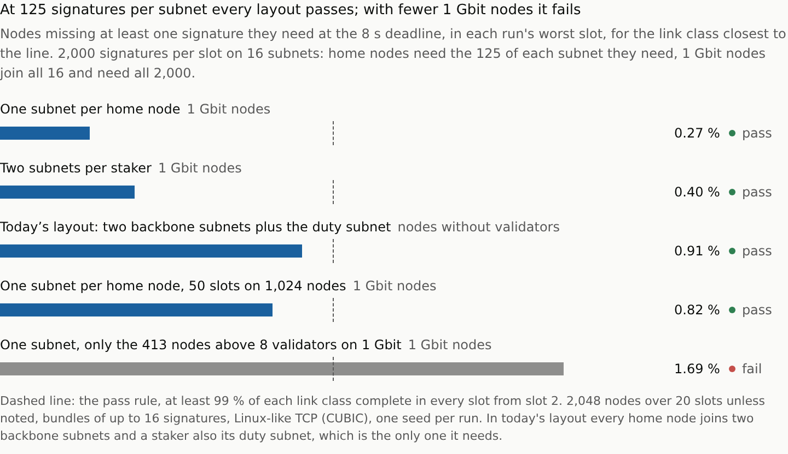

# Can PQ Gasper run on gossipsub?

*Draft of* 2026-11-12*.*

**Not with home stakers in the subnets.** PQ Gasper sends about 32k signatures per slot, 2,000 in each of 16 subnets. In Shadow, one gossipsub topic carrying 2,000 signatures per slot delivered all of them within 4 s to 1 Gbit nodes in 99.8 % of slots, but to home stakers in 1.4 %. Splitting the same 2,000 across 16 subnets, 125 per subnet, passes for every node, but that is a sixteenth of Gasper's load.

## Gasper is the easier change, if gossipsub can carry it

Ethlabs calls PQ Gasper versus PQ decoupled consensus "the biggest open question" for [pqai27](https://ethlabs.org/writings/pqai27.html): Gasper is "plausibly the easier change", but "it is less clear how many compromises that takes". [Potuz](https://www.potuz.net/posts/pq/) wants PQ Gasper shipped first and sets the test: "we need POCs on the CL right now to see whether gossipsub is even viable". If Gasper needs new slot or epoch parameters, he would rather move to decoupled consensus.

## A PQ Gasper subnet carries 2,000 signatures per slot

Every node in a subnet takes in and forwards all of its signatures within 4 s. A leanXMSS signature is 2,404 bytes ([leanVM](https://github.com/leanEthereum/leanVM)), so one subnet is about 4.8 MB per slot before duplicates.

## One subnet of 2,000 is too much for home uplinks

- Setup: every node in one topic, 2,000 signatures per slot in bundles of up to 16, sent 4.0–4.5 s into the slot. Nodes follow mainnet's validator distribution: 1 Gbit for every node with more than 8 validators plus a fifth of the rest, EIP-7870 links (50/25 Mbit/s with validators, 50/15 without) for the others.
- Home nodes needed 102–115 % of their uplink on average while signatures spread, up to 206 % for the busiest, and gossipsub dropped the forwards that did not fit.
- At 1.2 kB, half a leanXMSS signature, home stakers still had every signature in only 71 % of slots.

## Split across 16 subnets, the same 2,000 pass

- These runs add mainnet's latencies, packet loss, churn, client mix and peer scoring, and Linux-like TCP, on 2,048 nodes. Home nodes join one to three subnets of 125; 1 Gbit nodes join all 16.
- Every layout passes, including today's (two backbone subnets plus the duty subnet), which leaves no node to spare.
- Home stakers carried up to 375 signatures per slot. 1 Gbit nodes took in all 2,000, one PQ Gasper subnet's worth.

## What PQ Gasper on gossipsub would need

- **Smaller subnets.** Home stakers can join a subnet of roughly 400–500 signatures per slot: 375 passed here, and about 500 (1,000 of 1.2 kB) nearly passed on the clean network. At 32k per slot that means 64–80 subnets, or 16 subnets with validators consolidated to about 200–250k.
- **Or home nodes outside the subnets.** They would publish into subnets without joining them, and only 1 Gbit nodes would subscribe and aggregate. A 1 Gbit node handled 2,000 per slot in both setups; one in all 16 subnets would take in 32k, which is untested.
- **Or decoupled consensus.** Only a 512-member committee votes on the critical path. Finality votes still come from the full validator set, in 4 s units sized like today's attestation slot ([dc-networking](https://github.com/ethereum/dc-networking)), so the same per-subnet limit applies, but a late vote delays finality, not the chain.

## Caveats

- The single-subnet runs predate the realistic network: no packet loss, churn or peer scoring, and 512 nodes over 5 slots. Realism made every split cell harder, so it would not rescue them.
- One seed per run; mainnet has several times more nodes.
- Aggregation is not simulated. leanVM proves a 1,400-signature aggregate in 0.4–1.6 s (248 KiB) and merges 16 of them in another 0.4–1.7 s (358 KiB) on 8- to 32-core machines.
- The 1 Gbit share is an assumption.
- [Barnabé Monnot's aggregation model](https://github.com/barnabemonnot/pq-aggregation-model) uses the same per-node load, subnets × signatures × size × copies, but assumes 2 copies of each signature where our runs counted 4–5.
